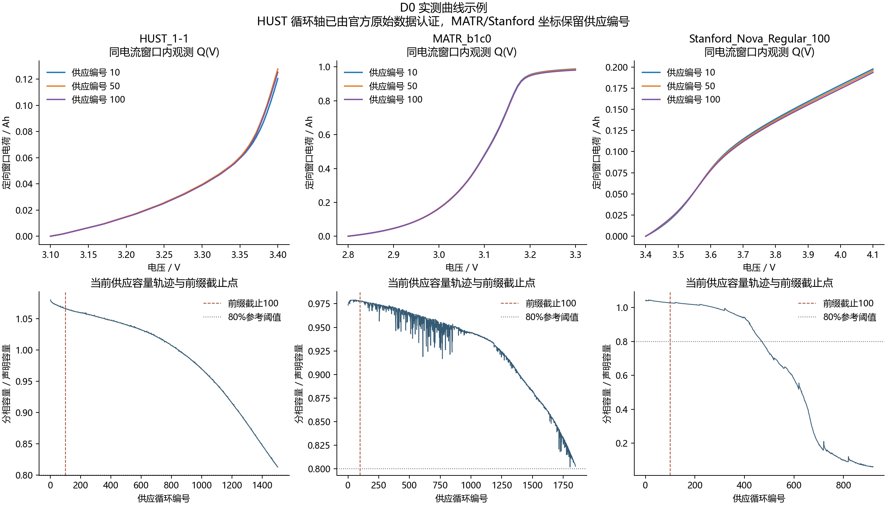

# SRSR Physics 早期先兆研究与新增SDU审计

执行日期为2026-11-15。

## 本轮已完成的范围

完成HUST、MATR、Stanford_2共427个供应电池的D0定向审计，恢复并安全解析HUST官方原始归档，执行早期物理响应特征预测未来平均退化速率的实验B，并独立完成新增SDU的完整元数据、全信号及D0支持审计。

历史响应研究已完成148次拟合。本轮复用其身份/来源记录，新增计算采用独立数据资格、测量定义和注册合同。

## D0实际支持

| 来源 | 供应电池 | 原始记录已恢复 | 供应K100完整且轴认证 | 观测曲线支持 | 中期斜率 | 晚期斜率 | 供应容量EOL事件/删失 |
|---|---|---|---|---|---|---|---|
| HUST | 77 | 77 | 76 | 77 | 77 | 77 | 0/77 |
| MATR | 169 | 0 | 0 | 169 | 151 | 40 | 88/81 |
| Stanford_2 | 181 | 0 | 0 | 181 | 181 | 98 | 181/0 |

曲线支持按K100内至少80个合格观测窗口统计。HUST的原始循环轴已认证，MATR和Stanford的斜率与事件采用供应编号。后两类的真实物理循环映射仍需原始记录。

HUST官方归档有77个电池、146122个原始循环。全部原始Cycle number列与周期键一致，前100个供应记录的V与I逐点重放一致，I为原始mA除以1000。HUST_7-5的供应文件从原始第3圈开始，本轮供应输入合同因此保留76个完整K100电池。

HUST原始记录有6个固定阶段。最后放电段在全部146122圈中约为2C，当前结构化元数据写为1C。前三段倍率与原始记录核对一致，作为本轮所有模型共有的已知设备/实验设计上下文。未来政策状态继续登记observed_only，控制器原始脚本及未来真实电芯温度缺少独立认证。

## 容量与未来目标的测量定义

主实验B使用原始Capacity(mAh)净计数，从第一放电阶段首个观测点减去最后放电阶段末点，并除以1000换算Ah，再除以声明容量1.1Ah。全部146122圈均通过单调性与跨阶段连续性检查。

供应重建容量/原始计数容量的每电池中位比为1.009700–1.024024，总体中位为1.016492。阶段转换处的容量计数保持不变，而时间跳过6–7秒，现有电流积分对这些边界区间计入电荷。这些采样与重建差异已保留为独立诊断。

`future_target_support.csv`记录供应容量定义，`HUST_RAW_CAPACITY_TARGET_SUPPORT.csv`记录原始计数定义。B的冻结合同明确引用后者的SHA，两个来源的数值分别保留。原始作者的rul/dq字段未用作本轮结局。

未来速率定义为r[a,b]=(SOH(a)−SOH(b))/(b−a)，端点采用±5个原始循环的中位值且至少5个有效观测。主目标为500–1000圈，次目标为200–500圈。

HUST的77个原始轨迹均未实际跨过80%阈值，EOL均记录为右删失。

## 膝点候选的有效性反例

注册hinge算法在光滑二次曲线和光滑指数曲线上分别给出稳定候选750和887，在构造的真实折点700上给出698。平滑窗口一致性无法单独识别局部膝转变。候选继续作为形状诊断保存，本轮认证knee_event为0，实验B使用平均退化速率。具体结果见KNEE_TARGET_VALIDITY_ZH.md及KNEE_NEGATIVE_CONTROLS.json。

## 实验B冻结合同

合格HUST为76颗，按旧576成员身份固定分为33训练、11验证、32测试，原始电池ID互斥。旧成员按SHA排序分训练/验证，新成员作为留出测试。该划分对应历史数据上的探索性留出。

每个三段倍率组合只有1颗电池，训练/验证/测试分别有33/11/32个组合，当前组合也互斥。该设计的分组误差保留支持数，条件内重复证据有限。

所有模型共享前三段放电倍率。容量组包括前缀容量水平、斜率和标准差，Q(V)组包括同电流窗口内的窗口电荷与跨循环变化量。StandardScaler仅在33颗训练电池拟合，Ridge的alpha从0.01、0.1、1、10、100按验证MAE选择，冻结系数和选择后计算10组测试预测。

本轮HUST Q(V)限定于5C附近充电的3.1–3.4V窗口，每圈电荷以窗口下界为零点，采用64点网格。统计结论对应当前窗口定义、七项曲线特征、Ridge模型与固定拆分。

当前新增的三段倍率上下文扩展了历史VIQ-only输入合同，所有对照使用相同上下文。温箱30°C为实验设计信息，电芯实测温度未作为本轮模型输入。

## 留出测试结果

MAE单位为10⁻⁵ SOH比例/原始循环。R²与Spearman按同一32颗测试电池计算。

| 目标 | 模型 | 测试N | MAE | R² | Spearman |
|---|---|---|---|---|---|
| 500–1000 | 训练均值 | 32 | 3.9271 | -0.0015 | 无定义 |
| 500–1000 | 倍率上下文 | 32 | 3.7255 | 0.1743 | 0.3805 |
| 500–1000 | 上下文＋早期容量 | 32 | 3.4020 | 0.2311 | 0.6037 |
| 500–1000 | 上下文＋Q(V) | 32 | 3.9109 | 0.1273 | 0.5143 |
| 500–1000 | 上下文＋容量＋Q(V) | 32 | 3.1316 | 0.3713 | 0.6312 |
| 200–500 | 训练均值 | 32 | 1.1158 | -0.0057 | 无定义 |
| 200–500 | 倍率上下文 | 32 | 1.1492 | 0.0408 | 0.0634 |
| 200–500 | 上下文＋早期容量 | 32 | 1.0334 | -0.0936 | 0.4289 |
| 200–500 | 上下文＋Q(V) | 32 | 1.0555 | 0.0733 | 0.4417 |
| 200–500 | 上下文＋容量＋Q(V) | 32 | 0.9549 | 0.1502 | 0.6466 |

500–1000圈目标，联合模型相对容量对照的MAE改善为2.7036348e-06，2000次测试电池配对bootstrap的95%区间为[-1.2174744e-06, 6.7151783e-06]。误差增大的测试电池为13/32，完整反例见negative_cases.csv。

200–500圈目标，联合模型相对容量对照的MAE改善为7.8435061e-07，2000次测试电池配对bootstrap的95%区间为[-2.5429103e-07, 1.9624075e-06]。误差增大的测试电池为14/32，完整反例见negative_cases.csv。

两个目标的改善区间均跨0。点估计支持进一步检验Q(V)的增量作用，当前留出样本不足以确证稳定改善。Q(V)组单独的主目标MAE也高于容量组。后续SRSR职责路由和动力学分支的主张需要更强验证。

## 新增SDU独立审计

新增SDU.zip包含86个供应电池、49146圈和73264808个同步测量点，全部元数据、每循环schema、全部数值、成员CRC/SHA和源归档前后SHA完成核验。86颗均为供应声明的NMC532/graphite、2.4Ah，充放电协议为空列表，温度全部有限，内阻全部为空。

温度范围为18.683–58.917°C，电压为1.999305–4.300264V，声明电压为3.0–4.2V。9199条后续重复V/I/Qc/Qd记录涉及83颗电池，已从独立D0候选中排除。删圈前的索引与重编号后的坐标分别保留，诊断替换的首个副本身份仍需原始CSV核验。

70/86寿命标签精确匹配，16个文件缺标签，6个标签超过当前观测范围。供应K100编号完整73颗，至少2个合格观测曲线70颗，至少80条47颗。

SDU中期/晚期斜率候选为36/24，供应坐标观察EOL事件77、右删失9。观测曲线与两个速率的候选交集为12。真实物理轴、ICA/DVA及未来策略认证交集为0，完整结果见SDU_DATA_AUDIT_ZH.md。

SDU初次使用与第二寿命的原始CSV有不同记录身份。当前供应zip的Protocol_ID和原始诊断位置未保留，新增SDU保持独立数据版本。

## 实际曲线与异常示例

图中HUST轴由官方原始记录认证，MATR/Stanford保留供应编号。纵轴容量为供应分相重建值，B的主目标采用另存的原始计数定义。

## 实现修复与验证

模型评分前修复了单次容量计数复位误接、无放电阶段容量污染、后缀排序阻断前缀、缓存未绑定代码/数据四项风险。每次完整扫描的私有缓存分别保留，最终结果来自v3重算。最终汇总又补足完整K100交集条件。

真实HUST_1-1的K10/50/100后缀极值、重排和删除验证通过，缺失首两圈及阶段污染等18项回归通过。SDU20项独立核验与86颗当前定义刷新通过，原始容量11项独立核验通过。Windows原子发布采用系统支持的非覆盖rename，首次注册的hardlink错误发生在测试预测之前。

## 优势与劣势（风险）

优势为HUST原始循环、阶段、容量计数与供应信号建立了实际来源链，且当前模型输入和未来结局分离、ID互斥、选择与评分有完整封存记录。新增SDU全部字段和真实支持数可追溯。

劣势（风险）为主实验训练33、验证11、测试32，倍率组合缺少重复，历史数据已有开发使用。未来工况计划与电芯温度认证有限，MATR/Stanford/SDU物理坐标和协议身份仍有缺口，膝点方法存在已验证的特异性反例。

## 置信度评级

数量、字段、哈希、原始HUST循环映射、测量定义和本轮数值结果的置信度为高。Q(V)对未来速率的稳定增量收益置信度为低，依据是两个改善区间均跨0及有限留出支持。跨材料、未来策略及具体微观退化机制的外推需要独立证据。

## 拓展思考

原始容量计数与电流积分对阶段边界的处理不同，会形成系统测量偏差。后续物理特征可同时追踪仪器计数、阶段边界和积分口径。

## 你可能想知道

SDU提供完整有限温度时序，而原始CSV还包含Protocol_ID和诊断信息。恢复这些身份可进一步判断同温度、同工况窗口下的真实物理特征支持。
