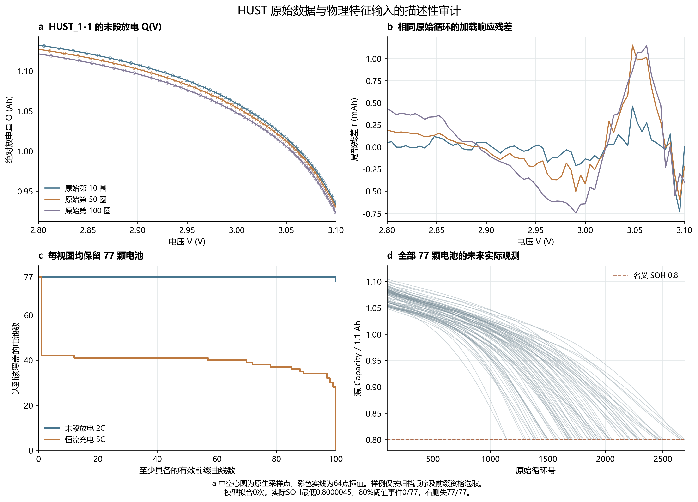

# HUST原始数据审计与物理响应方法的可实施性

## 判断与实际产物

**HUST具备构建前100个公开原始循环到未来可观测SOH轨迹任务的数据条件。** 已生成主放电视图的全部77颗输入、全局—局部响应特征、真实公开循环号动力学和未来容量监督。方法效果的证据需要来自训练比较，本报告记录数据、测量与接口的实施证据。

新下载`hust_raw.zip`的内层与既有官方归档逐字节一致，队列继承已有HUST探索暴露。当前全量重新审计覆盖77颗、146122圈、91736659个采样点，全部六通道、阶段、`rul/dq`及字段缺失均已实读。公开原始循环轴指文件内字典key与`Cycle number`列，两者逐点一致。直接仪器导出头、形成前史和校准记录仍缺失。完整证据见[原始审计](HUST_RAW_IDEA_AUDIT_ZH.md)。

## 哪些数据可以支持idea

| 内容 | 实际处理与支持 |
|---|---|
| 主要物理输入 | 末段D3实测约−2.2 A，2.8–3.1 V，前100圈7698/7700条合格曲线 |
| 主队列资格 | 77/77颗有合法参考、可辨识分解与SOH100容量锚点 |
| 次充电视图 | 约5.5 A，3.1–3.4 V，3897/7700条合格曲线，34/77颗输入合格 |
| 全局—局部输入 | 每圈20维global、64点位置保留残差、8窗各26维local及各自mask |
| 持续性输入 | 按原始循环距离计算的慢变、瞬态、方向一致性及斜率变化，10/50/100圈锚点 |
| 长期监督 | 原始101圈起138422个实际未来SOH观测点，逐电芯观测终止保留 |
| 两段平均衰减速率 | exact 200–500及500–1000端点各支持77颗 |
| EOL80 | 精确名义0.8事件0颗，右删失77颗 |

主视图选择基于公开阶段、电流与前缀支持。HUST原始放电包含四段电流切换，阶段间有电压回升，完整四段用于全周期容量，局部Q(V)采用独立固定激励阶段。MATR已有4C放电窗口，HUST采用自身实测2C末段窗口，各自参考和测量定义分别保留。

充电窗口原生采样较稀，合格曲线主要15–23点，主放电为43–85点、中位64点。64点网格表示插值坐标，原生支撑数量与电压间隙另外记录。充电34颗资格来自前10圈至少5条合格参考等依赖，全部77颗仍保留在资格母表。

下图给出确定性选取的首颗合格电芯的原生采样、插值与残差，两视图的覆盖分布及全部未来观测。图中曲线对应描述性数据审计，样例选择仅使用归档顺序和前缀资格。

## 数学、单位与因果范围

每个视图使用原始1–10圈至少5条合格曲线的逐点中位参考，分解`Q_n(V)-Q_ref(V)=a_n+b_n*dQ_ref/dV+r_n(V)`。Huber IRLS、SG(5,2)及最终加权正交沿用既有数学实现，窗口、阶段与原点由HUST单独定义。a以Ah、b以V计量，r保留电压位置。该分解定义带载电学响应，电极级LLI/LAM真值及特定微观退化模式缺少认证。

原字段`Capacity(mAh)`来自作者公开表。D3的绝对Q为D0首点净容量减去当前净容量，除1000得到Ah，同时保存原净容量及原点位置。充电视图逐圈认证起点为0。另一份shape表示在窗口高电压端归零，a/b/r使用绝对Q。

SOH主口径为完整放电量`(Q_D0_first-Q_D3_last)/1000/1.1`。源`dq`与这一容量直接算术闭合，源`rul`逐圈等于剩余公开记录数`N-cycle+1`。这两类源标签均保留为审计对象。输入数组仅由前100圈生成，SOH100锚点使用96–100圈有效完整放电容量中位数，两个视图的曲线资格与容量锚点依赖分别处理。跨电芯标准化统计由后续训练划分内拟合，当前交付保存未做总体标准化的数据。

## 必须保留的实际异常

- 论文及BatteryLife元数据把最后放电阶段写为1C，原始全量电流约2C。数据中同时保存设计值1C、前缀实测值约2C及冲突标志。策略输入包含论文设计与前缀可知观测，实际未来执行值保留为审计对象。
- `HUST_1-5/1`最高3.0998 V，`HUST_7-5/1`最高3.0109 V，未覆盖固定3.1 V上端，两条主曲线置mask。
- `HUST_7-7/2`充电阶段在目标窗口之后变为约3 A。目标窗口及其真实插值支撑仍为5C，资格依赖检查到最后实际支撑点，整阶段混合电流另外标记。
- `HUST_1-8/168`有36923秒间隔，另4处重复时间位于后缀。时间积分相关量单独缺支持，原容量保留，168圈增加测量可比性复核标记。逐电芯标志在`results/hust_raw_idea_audit_v2/cell_qualification_flags.csv`，精确cycle/row见`source_anomaly_details.json`。
- 原始表没有电芯实测温度、IR或完整静置采样。30℃为实验环境设定。ICA/DVA、电阻和极化量的认证字段为false，源容量通道的独立设备计量来源尚未认证。

电流公差0.055 A、窗口内及单调保留后至少15个原生点与12个不同电压、最大0.02 V反向步、至少0.011 Ah窗口跨度均为工程选择。窗口与门槛在任何预测性能比较之前登记。两轮初步支持记录保留了插值支撑计数一致性修复及当前电流依赖修复，最终派生只绑定修正后的配置和支持证明。覆盖80圈用于描述支持程度。

## 数据文件与使用入口

| 位置 | 内容 |
|---|---|
| `data/hust_raw_idea_v2/cells.parquet` | 77颗身份、协议、两视图资格、目标支持与认证状态 |
| `data/hust_raw_idea_v2/views/actual2C_loaded_response/early_inputs.npz` | 主要77×100×64 VIQ、参考、a/b/r及动态输入与mask |
| `data/hust_raw_idea_v2/views/common5C_charge_response/early_inputs.npz` | 独立充电视图与同一77颗母表 |
| 各视图`view_qualification.parquet` | 逐电芯参考、覆盖和失格原因 |
| 各视图`feature_diagnostics.parquet` | 逐圈重建、正交、条件数和来源曲线质量 |
| `data/hust_raw_idea_v2/future_soh.parquet` | 138422个未来观测、容量与原始圈号 |
| `data/hust_raw_idea_v2/source_capacity_trajectory.parquet` | 全146122圈源容量轨迹 |
| `data/hust_raw_idea_v2/policy_context.parquet` | 12维设计/前缀已知策略及来源 |
| `data/hust_raw_idea_v2/PROCESSING_REGISTRATION.json` | 配置、源码、源身份与最终prefix支持指纹 |
| `data/hust_raw_idea_v2/DATASET_COMPLETE.json` | 最终派生文件及SHA，原始生成时的完成状态 |
| `data/hust_raw_idea_v2/DATA_QUALIFICATION.json` | 独立QA通过后的最终数据资格证明 |
| `results/hust_raw_idea_audit_v2/FINAL_DATASET_QA.json` | 独立数据与正常模型接口核验 |

NPZ使用`allow_pickle=False`读取。模型接口采用现有13个输入键，尺寸P12/G20/L26，充放电两个视图分别消费自身`input_eligible`、参考和掩码。构建入口为`scripts/hust_raw_v2/build_idea_dataset.py`，原始来源位置由参数指定。完整配置位于`configs/hust_raw_idea_v2.json`，处理细节见[处理报告](HUST_RAW_IDEA_PROCESSING_ZH.md)。

## 独立核验与模型接口

独立QA共113项全部通过，实际包含全量来源及146122行容量的交叉核对、两视图每颗参考与分解重算、三颗真实源文件的5531圈容量及600条前缀视图重放、未来后缀扰动、掩码和电荷原点检查。两视图各执行七个模型的正常CPU入口，共14组前向检查，使用seed42未拟合权重，模型拟合次数与优化器更新次数均为0。

实际序列化FP32的ΔQ重建最大误差，放电为1.46144e-9 Ah，充电为1.17690e-9 Ah。保留的r32结合F64导数和IRLS权重，归一化加权投影最大分别1.49336e-8及1.82218e-8，均满足预设8倍FP32 epsilon的数值容差。原F64计算最大重建误差6.94e-18 Ah。原生支撑、数学分解和保存精度分别留有记录。

最终状态由`DATA_QUALIFICATION.json`记录为`DATA_QUALIFICATION_PASS`，它绑定原始派生完成证明、独立QA、配置及源审计SHA。原始`DATASET_COMPLETE.json`保留生成时的pending-independent-QA状态，其后续验证事实由资格证明承接。完整[独立QA回执](../results/hust_raw_idea_audit_v2/FINAL_DATASET_QA.json)的SHA为`586dbb3183d5ccb3692941fc0c99bd156754d405ba890c3eb3e103a2e8792ef5`。

## Stanford和MATR原始来源

MATR已具备4份MAT共10,870,637,553字节，固定169物理电芯对应174份原始CSV共21,837,210,616字节，另有174份Metadata和174份控制协议。526个源文件本轮全部重新读SHA并与来源清单匹配，44项已有数据冻结引用亦匹配，直接复用这些完整档案。

Stanford当前官方包`data_03032025.tgz`公布长度15,639,357,254字节。本地浏览器下载中的gzip首个tar成员为`._data_03032025`，符合该包，完整下载校验与内容审计仍待完成。已保存官方源页及HTTP长度回执。官方来源说明包含原始形成阶段和BEEP结构化/插值后的老化数据，老化仪器日志的认证需按具体文件内容核对。`dataset/DATA`实际属于Discovery Learning，已有独立来源标记。详细库存见[原始来源清单](../results/hust_raw_idea_audit_v2/OTHER_SOURCE_INVENTORY.json)。

## 优势、风险与置信度

优势为77颗主视图可用、原生采样较密、严格前缀与全未来观测衔接，三模块所需的曲线位置、循环动力学和速率/轨迹监督均已有具体数组。

风险包括源计量与控制冲突、个别中断、实际温度缺失及历史暴露。77颗各有不同的三段放电协议，每个精确协议仅一颗，协议内cell-to-cell方差缺少重复。主视图和充电次视图资格差异也影响比较的有效分母。

数据资格及处理实现的结论置信度为高，依据为全量来源核验、明确原点与支持表及113项独立检查。方法预测收益的证据层级为待验证，已完成证据覆盖数据工程和正常模型接口。

## 拓展思考

同一77颗同时有全容量轨迹和阶段波形，可以检验早期局部残差的变化与未来平均速率之间是否存在增量关联，并按实际测量支持约束解释范围。

## 你可能想知道

精确名义80%事件为0，公开源RUL的末值为1。未来轨迹与两段速率仍有全部77颗监督支持，结局删失状态按实际观测保存。
