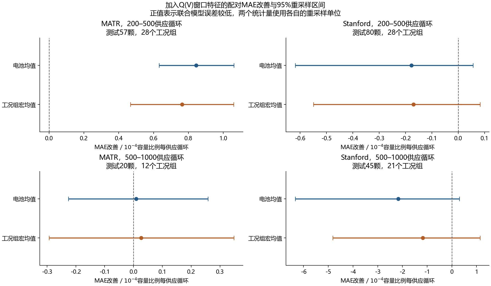

# MATR与Stanford早期曲线预测实验扩展

执行日期为2026-11-15。

## 覆盖修正与当前结论

上一轮D0包含MATR和Stanford，模型实验B仅执行HUST，覆盖不完整。本轮对MATR全部169颗和Stanford全部181颗完成资格连接、预注册、选模、留出评分与独立复核。

预测任务采用可追溯的供应循环编号和观测曲线。原始物理循环标定、插值及阶段语义作为证据字段保留。原始生成记录的缺口用于限定解释范围，现有合格观测支持可以进入相应坐标下的预测实验。

MATR的200–500目标显示明确的当前留出增量证据。MATR晚期目标及Stanford两个目标的联合模型改善区间跨0。Stanford最大失败是已核验的分布外线性外推，真实早期特征和冻结预测均可重放。

## 数据支持与固定拆分

| 来源 | 供应循环目标 | 总支持 | 训练 | 验证 | 测试 |
|---|---|---|---|---|---|
| MATR | 200–500 | 151 | 74 | 20 | 57 |
| MATR | 500–1000 | 40 | 15 | 5 | 20 |
| Stanford_2 | 200–500 | 181 | 75 | 26 | 80 |
| Stanford_2 | 500–1000 | 98 | 37 | 16 | 45 |

先在完整合格base队列固定电池ID角色，再对每个目标使用实际已观察的端点。同一目标内五个模型使用完全相同电池。MATR base为169颗，Stanford base为181颗。

主目标为200–500供应循环的平均容量比退化速率，次目标为500–1000。容量定义为放电电流阶段确认的最大容量减去有限全记录基线，再除以供应标称容量。端点窗口沿用±5供应循环、至少5个有效观测。晚期缺少观察的电池保留支持不足原因。

## 工况与早期输入合同

所有特征均来自供应编号不超过100的前缀。MATR采用2.8–3.3V共同放电窗口，Stanford采用3.4–4.1V。容量组三项和Q(V)组七项沿用已登记提取逻辑，曲线每圈以下界电压处电荷为零，64点网格。

五组模型均可获得同一份预测前上下文，包括训练均值、上下文、上下文＋容量、上下文＋Q(V)、上下文＋容量＋Q(V)。组标识仅用于分层和重采样。

MATR有14列有限先验。前三批124颗的原始快充policy已回收，SOC百分数转为比例，两段快充截止80%后共同1C补充。b4的45颗对应九种四段策略各五颗，依据供应值与原作者设计匹配。零占位与missing标志共同记录结构性缺段。[MATR来源核验](MATR_EXTENSION_QUALIFICATION_ZH.md)、[原始两段策略研究](https://www.nature.com/articles/s41560-019-0356-8)

Stanford有14列有限先验。原作者183行形成参数表与181颗供应文件全部精确匹配，包含六项形成设计参数和共同老化条件。当前交集形成参数元组63组，55组三重复、8组两重复。老化条件为1C充电、0.75C放电、3–4.4V、30°C温箱，电芯实测温度缺少有限值。[Stanford来源核验](STANFORD_EXTENSION_QUALIFICATION_ZH.md)、[官方数据](https://data.matr.io/8/)、[原作者参数表](https://github.com/cx26/formation-analysis/blob/main/data/Formation_2022-Parameter.csv)

新增的工况与形成先验扩展了VIQ-only信息预算，所有对照使用相同上下文。供应曲线与坐标的资格均已登记，严格IC/DVA、电阻和knee事件的认证状态延续前轮。

## 模型选择与封存

旧576成员按固定SHA排序以75%/25%分训练和验证，其他成员为留出测试。StandardScaler仅使用各目标的训练电池，Ridge的alpha为0.01、0.1、1、10、100，按验证MAE选择。全部已支持目标的系数先冻结，再计算测试预测。

本轮两个来源各10组测试预测，共1010条逐电池/目标/模型预测。选模覆盖均值控制与Ridge网格，历史HUST结果及其实现保持原提交内容。

## 主要留出结果

MAE单位为10⁻⁴容量比例/供应循环。相对MAE下降的正值表示误差减少，负值表示误差增加。

| 来源 | 目标 | 测试N | 上下文＋容量MAE | 联合Q(V) MAE | 相对MAE下降 | 容量对照R² | 联合R² |
|---|---|---|---|---|---|---|---|
| MATR | 200–500 | 57 | 1.7126 | 0.8686 | 49.28% | 0.2122 | 0.7236 |
| MATR | 500–1000 | 20 | 1.3460 | 1.3366 | 0.69% | -1.1574 | -1.1147 |
| Stanford_2 | 200–500 | 80 | 0.7925 | 0.9703 | -22.43% | 0.0930 | -2.2814 |
| Stanford_2 | 500–1000 | 45 | 4.2283 | 6.4007 | -51.38% | 0.0296 | -7.6711 |

MATR中期MAE由1.71256e-4降为8.68552e-5，降低49.28%，R²由0.2122升至0.7236。其电池配对改善95%区间为[6.32254e-5,1.06060e-4]，工况组宏均值改善区间为[4.67487e-5,1.05998e-4]，两者下界均为正。该结论对应当前数据、窗口、模型和拆分。

MATR晚期支持只有40颗，测试20颗。联合增量区间跨0，完整五组结果保留QV单独组与联合组的差异。

Stanford两个目标中，联合模型的MAE均高于容量对照，区间均跨0。数据的观测支持、排序关联与当前模型的误差表现分别记录。

## 电池与工况组不确定性

下表改善单位同为10⁻⁴容量比例/供应循环。电池统计量采用测试电池等权均值，工况统计量先计算每个工况的均值再对组等权，二者分别以2000次重采样形成95%区间。

| 来源 | 目标 | 电池改善及95%区间 | 工况宏改善及95%区间 | 测试工况组 | 误差恶化电池 |
|---|---|---|---|---|---|
| MATR | 200–500 | 0.84401 [0.63225, 1.06060] | 0.76377 [0.46749, 1.05998] | 28 | 10/57 |
| MATR | 500–1000 | 0.00934 [-0.22546, 0.25848] | 0.02681 [-0.29303, 0.34786] | 12 | 12/20 |
| Stanford_2 | 200–500 | -0.17774 [-0.61829, 0.05596] | -0.16997 [-0.54940, 0.08300] | 28 | 39/80 |
| Stanford_2 | 500–1000 | -2.17238 [-6.33607, 0.30934] | -1.17978 [-4.81919, 1.14140] | 21 | 23/45 |

## 工况覆盖与Stanford失败诊断

以下为封存后的描述性诊断。MATR中期测试57颗分为28个设计参数组，其中22颗所在组在相应训练中出现，35颗属于未在训练出现的组。两层配对改善分别为6.38128e-5和9.73421e-5，完整支持数和反例保存在extension_analysis。

Stanford中期测试80颗的28个形成参数组、晚期测试45颗的21个组，均与训练/验证的完整六参数元组无交集。原拆分依据legacy身份注册，当前分组差异是实际数据属性。

Stanford_Nova_Regular_270的窗口电荷比训练均值低约9个标准差。晚期联合预测为−0.0088779，真实观察目标为0.0002381。该例占中期/晚期完整测试平方误差约72.04%/86.23%。

对270、320、124、280、279五颗重新读取现有源文件的前100圈，登记特征逐值重现，窗口全部合格、相关通道有限，容量比也在登记有效范围内。125条联合预测使用冻结参数重放的最大差为8.67e-19。结果支持当前线性模型在有限训练覆盖下发生极端外推，诊断保留全部原评分和样本。详见STANFORD_PREDICTION_FAILURE_DIAGNOSTIC_ZH.md。

## 五组完整结果

| 来源 | 目标 | 模型 | 测试N | MAE | RMSE | R² | Spearman |
|---|---|---|---|---|---|---|---|
| MATR | r200_500 | 训练均值 | 57 | 1.92432 | 2.28991 | -0.03040 | 无定义 |
| MATR | r200_500 | 已知工况上下文 | 57 | 1.70147 | 2.03456 | 0.18660 | 0.53283 |
| MATR | r200_500 | 上下文＋早期容量 | 57 | 1.71256 | 2.00223 | 0.21224 | 0.56352 |
| MATR | r200_500 | 上下文＋Q(V) | 57 | 1.00573 | 1.37171 | 0.63026 | 0.71027 |
| MATR | r200_500 | 上下文＋容量＋Q(V) | 57 | 0.86855 | 1.18600 | 0.72360 | 0.73334 |
| MATR | r500_1000 | 训练均值 | 20 | 0.92151 | 1.18584 | -0.00706 | 无定义 |
| MATR | r500_1000 | 已知工况上下文 | 20 | 1.10084 | 1.53457 | -0.68648 | 0.52091 |
| MATR | r500_1000 | 上下文＋早期容量 | 20 | 1.34597 | 1.73564 | -1.15737 | 0.12331 |
| MATR | r500_1000 | 上下文＋Q(V) | 20 | 0.82876 | 1.06781 | 0.18343 | 0.41504 |
| MATR | r500_1000 | 上下文＋容量＋Q(V) | 20 | 1.33663 | 1.71840 | -1.11474 | 0.27669 |
| Stanford_2 | r200_500 | 训练均值 | 80 | 0.97006 | 1.17441 | -0.26444 | 无定义 |
| Stanford_2 | r200_500 | 已知工况上下文 | 80 | 0.81511 | 1.01008 | 0.06464 | 0.52186 |
| Stanford_2 | r200_500 | 上下文＋早期容量 | 80 | 0.79254 | 0.99466 | 0.09300 | 0.61983 |
| Stanford_2 | r200_500 | 上下文＋Q(V) | 80 | 0.88195 | 1.38162 | -0.75002 | 0.67822 |
| Stanford_2 | r200_500 | 上下文＋容量＋Q(V) | 80 | 0.97028 | 1.89189 | -2.28136 | 0.73549 |
| Stanford_2 | r500_1000 | 训练均值 | 45 | 4.62630 | 5.11128 | -0.05782 | 无定义 |
| Stanford_2 | r500_1000 | 已知工况上下文 | 45 | 4.17931 | 4.87626 | 0.03723 | 0.23850 |
| Stanford_2 | r500_1000 | 上下文＋早期容量 | 45 | 4.22833 | 4.89562 | 0.02957 | 0.24190 |
| Stanford_2 | r500_1000 | 上下文＋Q(V) | 45 | 4.60266 | 5.97521 | -0.44563 | 0.33004 |
| Stanford_2 | r500_1000 | 上下文＋容量＋Q(V) | 45 | 6.40071 | 14.63392 | -7.67105 | 0.36271 |

## 独立核验与历史记录

MULTIFAMILY_EXTENSION_QA.json包含106项独立检查，覆盖每目标ID与mask、输入和核心代码SHA、训练标准化、验证alpha、Ridge正规方程、1010条预测、全部指标、两类bootstrap与负例，以及源policy/形成参数逐值转换。核验调用模型拟合和测试评价入口次数为0。

旧HUST模型、输入、D0和SDU产物对应历史提交e8a7295，保持原科学记录。README新增本轮索引，新交付清单单独封存本轮仓库快照，历史DELIVERY_MANIFEST继续锚定旧提交。

## 优势与劣势（风险）

优势为两个来源全部早期合格电池纳入base，按各目标保留151/40与181/98的有效支持，元数据与曲线派生特征的增量关系可直接检验，并同时保留电池和工况组层面统计。

劣势（风险）为历史数据开发暴露、单次固定拆分、晚期支持较少、观测长度条件化，以及供应编号和插值处理的解释限制。工况先验均在预测前可用，当前结果的误差统计仍以已观察测试队列为条件。

## 置信度评级

当前可用性、元数据连接、预测和区间重算的置信度为高。MATR中期增量作用在当前留出条件下的证据评级为中，依据是电池与工况组区间方向一致，但缺少独立新数据和重复拆分。MATR晚期与Stanford联合增量证据评级为低，依据是配对区间跨0及已记录外推失败。

## 拓展思考

Stanford的共同老化条件与形成历史分别影响任务分层。形成参数组的覆盖结构能够解释一部分训练和测试分布差异，已纳入后续研究记录。

## 你可能想知道

MATR的45颗b4具有九种四段快充设计，每种五颗。它们的观测输入和已发表设计已全部接入本轮上下文与预测任务。
