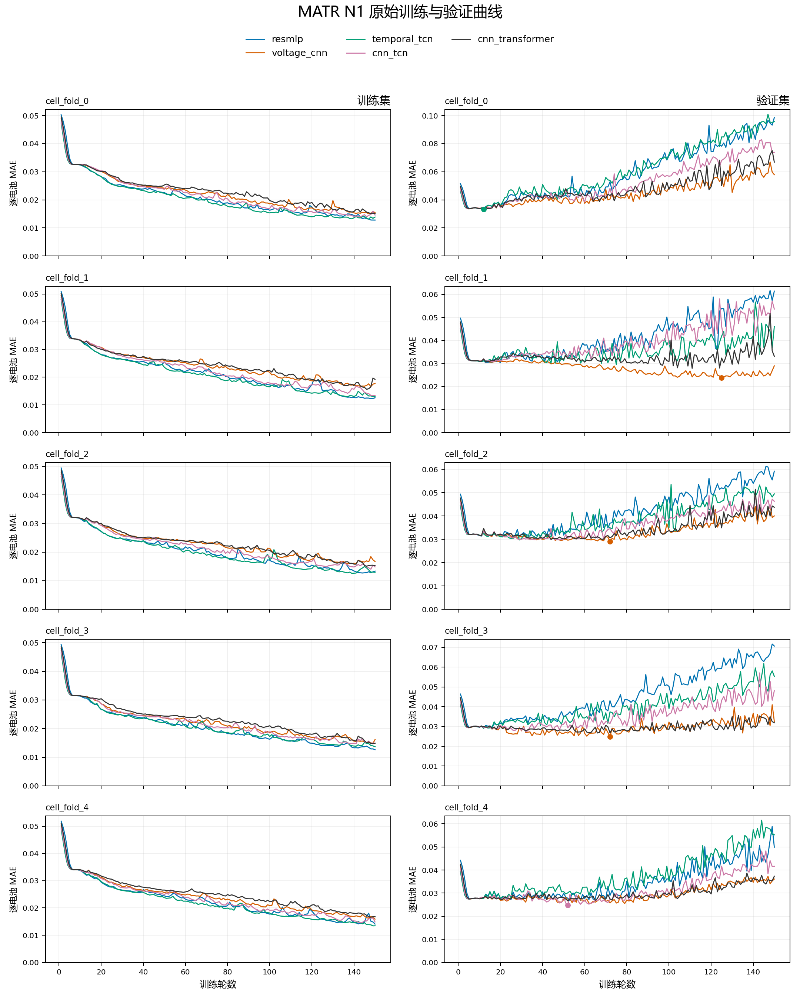
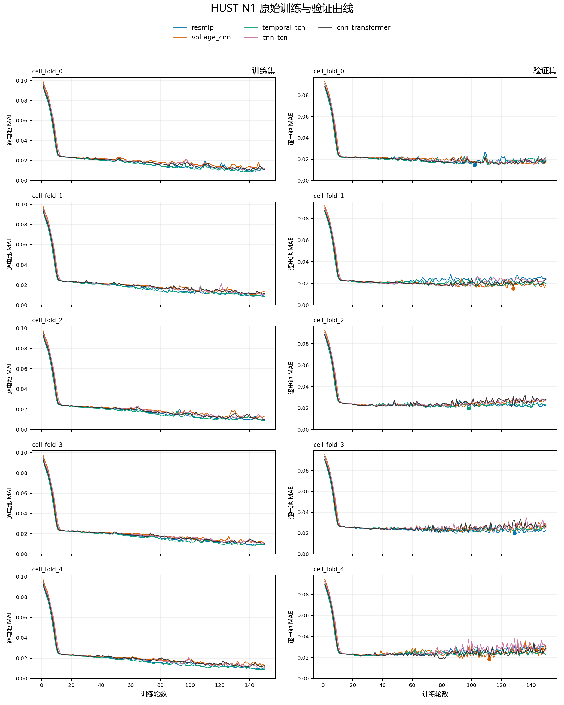

# N1 五种独立编码器比较

本轮登记日期为2026-11-16，沿用用户直接要求的seed42。全部MATR169和HUST77分别进行单域五折实验。每组150轮、batch8、宽度64、AdamW学习率0.0003、weight decay0.01、梯度裁剪1.0。损失为完整实际观测后缀逐电池等权MAE，选权遵循本折内部验证MAE的strict first-min。所有曲线保留原始150轮，源数据和划分在训练前封存。

MATR拥有123,431个未来观测，HUST拥有138,422个。全部未来观测均保持原始周期与mask，窗口支持不足时记录缺失。SOH使用1.1Ah名义容量归一化，SOH100锚点采用真实96–100圈有效容量中位数。每域分别拟合训练电池的有效点标准化。两域的物理电压窗口和策略维数保持各自定义。

所有队列均有历史研究暴露，本轮属于内部回顾性验证。单种子无法估计训练种子方差。bootstrap区间为当前拟合预测上的条件区间，进行了多个预登记探索性比较。HUST77个精确协议各只有一颗电池，协议重采样缺少组内重复支持。

N1只改变编码器，统一query_mlp。resmlp使用64维逐周期残差MLP，voltage_cnn使用两层电压卷积，temporal_tcn使用逐周期平面MLP与六层时间卷积，cnn_tcn使用电压卷积与六层时间卷积，cnn_transformer使用电压卷积与一层四头Transformer。各模型共同使用实际循环、上一有效循环间隔、可用性、策略值和掩码，池化前缀后结合SOH100预测未来。

参数量存在差异，因此同宽度、同训练预算的比较仍包含容量差异。每外折的选择仅使用该折内部验证电池，跨折测试结果为描述性评价，当前没有通过全局测试均值选定唯一论文backbone。

## 完整未来轨迹

| domain | method | cell_mean_mae | cell_mean_rmse | protocol_macro_mae | protocol_macro_rmse | supported_cells | observations | min_parameters | max_parameters |
| --- | --- | --- | --- | --- | --- | --- | --- | --- | --- |
| HUST | cnn_tcn | 0.024037873 | 0.033333521 | 0.024037873 | 0.033333521 | 77 | 138422 | 104273 | 104273 |
| HUST | cnn_transformer | 0.022522225 | 0.031491977 | 0.022522225 | 0.031491977 | 77 | 138422 | 85521 | 85521 |
| HUST | nested | 0.023898472 | 0.032261011 | 0.023898472 | 0.032261011 | 77 | 138422 | 43905 | 87681 |
| HUST | resmlp | 0.023879293 | 0.032497387 | 0.023879293 | 0.032497387 | 77 | 138422 | 43905 | 43905 |
| HUST | temporal_tcn | 0.023300446 | 0.031716642 | 0.023300446 | 0.031716642 | 77 | 138422 | 87681 | 87681 |
| HUST | voltage_cnn | 0.024759701 | 0.033231070 | 0.024759701 | 0.033231070 | 77 | 138422 | 52049 | 52049 |
| MATR | cnn_tcn | 0.031218887 | 0.052609936 | 0.030646606 | 0.050435878 | 169 | 123431 | 104465 | 104465 |
| MATR | cnn_transformer | 0.030211439 | 0.050990477 | 0.029688045 | 0.048684328 | 169 | 123431 | 85713 | 85713 |
| MATR | nested | 0.030660366 | 0.051671412 | 0.030226917 | 0.049618942 | 169 | 123431 | 52241 | 104465 |
| MATR | resmlp | 0.032506189 | 0.054649738 | 0.032849578 | 0.053632609 | 169 | 123431 | 44097 | 44097 |
| MATR | temporal_tcn | 0.031494071 | 0.053427035 | 0.032192478 | 0.053211156 | 169 | 123431 | 87873 | 87873 |
| MATR | voltage_cnn | 0.030225115 | 0.050621674 | 0.029737053 | 0.048566581 | 169 | 123431 | 52241 | 52241 |

## 折内验证选择

| domain | fold | selected_encoder | N1_validation_mae |
| --- | --- | --- | --- |
| MATR | cell_fold_0 | temporal_tcn | 0.033303366 |
| MATR | cell_fold_1 | voltage_cnn | 0.023864369 |
| MATR | cell_fold_2 | voltage_cnn | 0.029031924 |
| MATR | cell_fold_3 | voltage_cnn | 0.024773593 |
| MATR | cell_fold_4 | cnn_tcn | 0.024813407 |
| HUST | cell_fold_0 | resmlp | 0.014405510 |
| HUST | cell_fold_1 | voltage_cnn | 0.015350718 |
| HUST | cell_fold_2 | temporal_tcn | 0.019631466 |
| HUST | cell_fold_3 | resmlp | 0.019888294 |
| HUST | cell_fold_4 | voltage_cnn | 0.018538763 |

选择在候选测试评分之前封存。正式all入口先封存该域N1与N2选择，再统一产生测试预测。nested是各折自身验证选择构成的OOF方法，逐电池合并等权汇总。

## 四时距与有效分母

| domain | method | window | cell_mean_mae | cell_mean_rmse | protocol_macro_mae | supported_cells | supported_protocols | observations |
| --- | --- | --- | --- | --- | --- | --- | --- | --- |
| HUST | cnn_tcn | 1001_plus | 0.042884494 | 0.048088603 | 0.042884494 | 77 | 77 | 69122 |
| HUST | cnn_tcn | 101_200 | 0.001269841 | 0.001429557 | 0.001269841 | 77 | 77 | 7700 |
| HUST | cnn_tcn | 201_500 | 0.005072317 | 0.005481174 | 0.005072317 | 77 | 77 | 23100 |
| HUST | cnn_tcn | 501_1000 | 0.014692580 | 0.015712550 | 0.014692580 | 77 | 77 | 38500 |
| HUST | cnn_transformer | 1001_plus | 0.040794022 | 0.045641756 | 0.040794022 | 77 | 77 | 69122 |
| HUST | cnn_transformer | 101_200 | 0.001230254 | 0.001373645 | 0.001230254 | 77 | 77 | 7700 |
| HUST | cnn_transformer | 201_500 | 0.004531650 | 0.004906223 | 0.004531650 | 77 | 77 | 23100 |
| HUST | cnn_transformer | 501_1000 | 0.013066717 | 0.014120675 | 0.013066717 | 77 | 77 | 38500 |
| HUST | nested | 1001_plus | 0.041782564 | 0.046189117 | 0.041782564 | 77 | 77 | 69122 |
| HUST | nested | 101_200 | 0.001730989 | 0.001932488 | 0.001730989 | 77 | 77 | 7700 |
| HUST | nested | 201_500 | 0.005649266 | 0.005983401 | 0.005649266 | 77 | 77 | 23100 |
| HUST | nested | 501_1000 | 0.013323361 | 0.014236796 | 0.013323361 | 77 | 77 | 38500 |
| HUST | resmlp | 1001_plus | 0.041840988 | 0.046611868 | 0.041840988 | 77 | 77 | 69122 |
| HUST | resmlp | 101_200 | 0.001513660 | 0.001691319 | 0.001513660 | 77 | 77 | 7700 |
| HUST | resmlp | 201_500 | 0.005328767 | 0.005711450 | 0.005328767 | 77 | 77 | 23100 |
| HUST | resmlp | 501_1000 | 0.013698001 | 0.014581948 | 0.013698001 | 77 | 77 | 38500 |
| HUST | temporal_tcn | 1001_plus | 0.041227514 | 0.045704536 | 0.041227514 | 77 | 77 | 69122 |
| HUST | temporal_tcn | 101_200 | 0.001496237 | 0.001671258 | 0.001496237 | 77 | 77 | 7700 |
| HUST | temporal_tcn | 201_500 | 0.005035533 | 0.005400050 | 0.005035533 | 77 | 77 | 23100 |
| HUST | temporal_tcn | 501_1000 | 0.013366651 | 0.014274429 | 0.013366651 | 77 | 77 | 38500 |
| HUST | voltage_cnn | 1001_plus | 0.042901634 | 0.047261071 | 0.042901634 | 77 | 77 | 69122 |
| HUST | voltage_cnn | 101_200 | 0.001529557 | 0.001714292 | 0.001529557 | 77 | 77 | 7700 |
| HUST | voltage_cnn | 201_500 | 0.005498078 | 0.005888909 | 0.005498078 | 77 | 77 | 23100 |
| HUST | voltage_cnn | 501_1000 | 0.015116615 | 0.016155285 | 0.015116615 | 77 | 77 | 38500 |
| MATR | cnn_tcn | 1001_plus | 0.096278028 | 0.100076293 | 0.102951371 | 40 | 19 | 10614 |
| MATR | cnn_tcn | 101_200 | 0.003039206 | 0.003517855 | 0.003808632 | 169 | 77 | 16865 |
| MATR | cnn_tcn | 201_500 | 0.017862609 | 0.023087955 | 0.024249714 | 168 | 76 | 49795 |
| MATR | cnn_tcn | 501_1000 | 0.073848489 | 0.086368102 | 0.091406289 | 151 | 61 | 46157 |
| MATR | cnn_transformer | 1001_plus | 0.090737232 | 0.094331051 | 0.098673738 | 40 | 19 | 10614 |
| MATR | cnn_transformer | 101_200 | 0.002749849 | 0.003185009 | 0.003542310 | 169 | 77 | 16865 |
| MATR | cnn_transformer | 201_500 | 0.016349522 | 0.021338754 | 0.022774189 | 168 | 76 | 49795 |
| MATR | cnn_transformer | 501_1000 | 0.070650759 | 0.082654451 | 0.086710044 | 151 | 61 | 46157 |
| MATR | nested | 1001_plus | 0.095333926 | 0.099167837 | 0.105828068 | 40 | 19 | 10614 |
| MATR | nested | 101_200 | 0.002470130 | 0.002866310 | 0.003273231 | 169 | 77 | 16865 |
| MATR | nested | 201_500 | 0.015651066 | 0.020733247 | 0.022147746 | 168 | 76 | 49795 |
| MATR | nested | 501_1000 | 0.071039727 | 0.082896811 | 0.087063042 | 151 | 61 | 46157 |
| MATR | resmlp | 1001_plus | 0.103887461 | 0.107729195 | 0.111711806 | 40 | 19 | 10614 |
| MATR | resmlp | 101_200 | 0.002975840 | 0.003449564 | 0.003787012 | 169 | 77 | 16865 |
| MATR | resmlp | 201_500 | 0.018400872 | 0.023810541 | 0.026185965 | 168 | 76 | 49795 |
| MATR | resmlp | 501_1000 | 0.074996836 | 0.087709576 | 0.094369144 | 151 | 61 | 46157 |
| MATR | temporal_tcn | 1001_plus | 0.088138837 | 0.091702847 | 0.100990144 | 40 | 19 | 10614 |
| MATR | temporal_tcn | 101_200 | 0.002796780 | 0.003240103 | 0.003525405 | 169 | 77 | 16865 |
| MATR | temporal_tcn | 201_500 | 0.018056580 | 0.023612049 | 0.026074289 | 168 | 76 | 49795 |
| MATR | temporal_tcn | 501_1000 | 0.075142739 | 0.087702789 | 0.093880340 | 151 | 61 | 46157 |
| MATR | voltage_cnn | 1001_plus | 0.094021079 | 0.097880266 | 0.104819209 | 40 | 19 | 10614 |
| MATR | voltage_cnn | 101_200 | 0.002522422 | 0.002925212 | 0.003339054 | 169 | 77 | 16865 |
| MATR | voltage_cnn | 201_500 | 0.015429362 | 0.020346027 | 0.021681335 | 168 | 76 | 49795 |
| MATR | voltage_cnn | 501_1000 | 0.068689191 | 0.080322045 | 0.084568664 | 151 | 61 | 46157 |

MATR在1001圈后有40颗轨迹支持，HUST在该窗口有77颗。此支持与早期输入资格分别记录，缺少远期观测的电池仍保留在完整后缀任务中。

## 预登记配对比较

| domain | metric | candidate | reference | sampling_unit | improvement | ci95_low | ci95_high | better_cells | worse_cells | paired_cells |
| --- | --- | --- | --- | --- | --- | --- | --- | --- | --- | --- |
| HUST | mae | N1:voltage_cnn | N1:resmlp | cell | -0.000880408 | -0.003016948 | 0.001412813 | 37 | 40 | 77 |
| HUST | mae | N1:voltage_cnn | N1:resmlp | protocol_group | -0.000880408 | -0.002972906 | 0.001304897 | 37 | 40 | 77 |
| HUST | mae | N1:temporal_tcn | N1:resmlp | cell | 0.000578847 | -0.000725562 | 0.001971520 | 38 | 39 | 77 |
| HUST | mae | N1:temporal_tcn | N1:resmlp | protocol_group | 0.000578847 | -0.000645350 | 0.001983849 | 38 | 39 | 77 |
| HUST | mae | N1:cnn_tcn | N1:resmlp | cell | -0.000158579 | -0.002366309 | 0.002263417 | 29 | 48 | 77 |
| HUST | mae | N1:cnn_tcn | N1:resmlp | protocol_group | -0.000158579 | -0.002239677 | 0.002243621 | 29 | 48 | 77 |
| HUST | mae | N1:cnn_transformer | N1:resmlp | cell | 0.001357068 | -0.000841260 | 0.003603537 | 45 | 32 | 77 |
| HUST | mae | N1:cnn_transformer | N1:resmlp | protocol_group | 0.001357068 | -0.000580439 | 0.003736649 | 45 | 32 | 77 |
| HUST | rmse | N1:voltage_cnn | N1:resmlp | cell | -0.000733683 | -0.003156574 | 0.001751944 | 41 | 36 | 77 |
| HUST | rmse | N1:voltage_cnn | N1:resmlp | protocol_group | -0.000733683 | -0.003003263 | 0.001717959 | 41 | 36 | 77 |
| HUST | rmse | N1:temporal_tcn | N1:resmlp | cell | 0.000780745 | -0.000725183 | 0.002349698 | 40 | 37 | 77 |
| HUST | rmse | N1:temporal_tcn | N1:resmlp | protocol_group | 0.000780745 | -0.000652831 | 0.002357596 | 40 | 37 | 77 |
| HUST | rmse | N1:cnn_tcn | N1:resmlp | cell | -0.000836134 | -0.003402761 | 0.002066303 | 36 | 41 | 77 |
| HUST | rmse | N1:cnn_tcn | N1:resmlp | protocol_group | -0.000836134 | -0.003279651 | 0.001962228 | 36 | 41 | 77 |
| HUST | rmse | N1:cnn_transformer | N1:resmlp | cell | 0.001005409 | -0.001440125 | 0.003518537 | 43 | 34 | 77 |
| HUST | rmse | N1:cnn_transformer | N1:resmlp | protocol_group | 0.001005409 | -0.001338107 | 0.003687625 | 43 | 34 | 77 |
| MATR | mae | N1:voltage_cnn | N1:resmlp | cell | 0.002281073 | 0.000234054 | 0.004348733 | 115 | 54 | 169 |
| MATR | mae | N1:voltage_cnn | N1:resmlp | protocol_group | 0.003112525 | 0.000477958 | 0.005808947 | 115 | 54 | 169 |
| MATR | mae | N1:temporal_tcn | N1:resmlp | cell | 0.001012117 | -0.000895465 | 0.003026146 | 75 | 94 | 169 |
| MATR | mae | N1:temporal_tcn | N1:resmlp | protocol_group | 0.000657100 | -0.001505085 | 0.003146710 | 75 | 94 | 169 |
| MATR | mae | N1:cnn_tcn | N1:resmlp | cell | 0.001287302 | -0.000036895 | 0.002922477 | 95 | 74 | 169 |
| MATR | mae | N1:cnn_tcn | N1:resmlp | protocol_group | 0.002202972 | 0.000531939 | 0.004095626 | 95 | 74 | 169 |
| MATR | mae | N1:cnn_transformer | N1:resmlp | cell | 0.002294749 | 0.000216810 | 0.004335787 | 94 | 75 | 169 |
| MATR | mae | N1:cnn_transformer | N1:resmlp | protocol_group | 0.003161533 | 0.000551019 | 0.005930928 | 94 | 75 | 169 |
| MATR | mae | N1:resmlp | HISTORICAL:M1 | cell | -0.013744225 | -0.016539208 | -0.011189145 | 19 | 150 | 169 |
| MATR | mae | N1:resmlp | HISTORICAL:M1 | protocol_group | -0.015860796 | -0.018766942 | -0.013230121 | 19 | 150 | 169 |
| MATR | mae | N1:voltage_cnn | HISTORICAL:M1 | cell | -0.011463152 | -0.014363097 | -0.008631317 | 31 | 138 | 169 |
| MATR | mae | N1:voltage_cnn | HISTORICAL:M1 | protocol_group | -0.012748271 | -0.016156739 | -0.009473221 | 31 | 138 | 169 |
| MATR | mae | N1:temporal_tcn | HISTORICAL:M1 | cell | -0.012732108 | -0.015327626 | -0.010304303 | 24 | 145 | 169 |
| MATR | mae | N1:temporal_tcn | HISTORICAL:M1 | protocol_group | -0.015203696 | -0.018225386 | -0.012242232 | 24 | 145 | 169 |
| MATR | mae | N1:cnn_tcn | HISTORICAL:M1 | cell | -0.012456923 | -0.014794391 | -0.010293375 | 24 | 145 | 169 |
| MATR | mae | N1:cnn_tcn | HISTORICAL:M1 | protocol_group | -0.013657824 | -0.016132518 | -0.011334453 | 24 | 145 | 169 |
| MATR | mae | N1:cnn_transformer | HISTORICAL:M1 | cell | -0.011449475 | -0.014124158 | -0.008841598 | 27 | 142 | 169 |
| MATR | mae | N1:cnn_transformer | HISTORICAL:M1 | protocol_group | -0.012699263 | -0.015732447 | -0.009452012 | 27 | 142 | 169 |
| MATR | mae | N1:nested | HISTORICAL:M1 | cell | -0.011898402 | -0.014627287 | -0.009270512 | 27 | 142 | 169 |
| MATR | mae | N1:nested | HISTORICAL:M1 | protocol_group | -0.013238135 | -0.016351503 | -0.010121767 | 27 | 142 | 169 |
| MATR | rmse | N1:voltage_cnn | N1:resmlp | cell | 0.004028063 | 0.001264344 | 0.006623155 | 116 | 53 | 169 |
| MATR | rmse | N1:voltage_cnn | N1:resmlp | protocol_group | 0.005066029 | 0.001777337 | 0.008655959 | 116 | 53 | 169 |
| MATR | rmse | N1:temporal_tcn | N1:resmlp | cell | 0.001222702 | -0.001328983 | 0.003850573 | 71 | 98 | 169 |
| MATR | rmse | N1:temporal_tcn | N1:resmlp | protocol_group | 0.000421453 | -0.002137962 | 0.003442979 | 71 | 98 | 169 |
| MATR | rmse | N1:cnn_tcn | N1:resmlp | cell | 0.002039802 | 0.000337442 | 0.004030201 | 106 | 63 | 169 |
| MATR | rmse | N1:cnn_tcn | N1:resmlp | protocol_group | 0.003196731 | 0.000991415 | 0.005692350 | 106 | 63 | 169 |
| MATR | rmse | N1:cnn_transformer | N1:resmlp | cell | 0.003659261 | 0.000956646 | 0.006424667 | 100 | 69 | 169 |
| MATR | rmse | N1:cnn_transformer | N1:resmlp | protocol_group | 0.004948282 | 0.001585454 | 0.008428073 | 100 | 69 | 169 |
| MATR | rmse | N1:resmlp | HISTORICAL:M1 | cell | -0.023071191 | -0.027057513 | -0.019104238 | 21 | 148 | 169 |
| MATR | rmse | N1:resmlp | HISTORICAL:M1 | protocol_group | -0.026882267 | -0.031511245 | -0.022743368 | 21 | 148 | 169 |
| MATR | rmse | N1:voltage_cnn | HISTORICAL:M1 | cell | -0.019043128 | -0.023385783 | -0.014848508 | 31 | 138 | 169 |
| MATR | rmse | N1:voltage_cnn | HISTORICAL:M1 | protocol_group | -0.021816238 | -0.026601217 | -0.017218527 | 31 | 138 | 169 |
| MATR | rmse | N1:temporal_tcn | HISTORICAL:M1 | cell | -0.021848489 | -0.025865210 | -0.017881880 | 27 | 142 | 169 |
| MATR | rmse | N1:temporal_tcn | HISTORICAL:M1 | protocol_group | -0.026460814 | -0.031239392 | -0.021703461 | 27 | 142 | 169 |
| MATR | rmse | N1:cnn_tcn | HISTORICAL:M1 | cell | -0.021031390 | -0.024593390 | -0.017514248 | 20 | 149 | 169 |
| MATR | rmse | N1:cnn_tcn | HISTORICAL:M1 | protocol_group | -0.023685535 | -0.027837907 | -0.019859548 | 20 | 149 | 169 |
| MATR | rmse | N1:cnn_transformer | HISTORICAL:M1 | cell | -0.019411930 | -0.023570319 | -0.015417823 | 28 | 141 | 169 |
| MATR | rmse | N1:cnn_transformer | HISTORICAL:M1 | protocol_group | -0.021933985 | -0.026544291 | -0.017175456 | 28 | 141 | 169 |
| MATR | rmse | N1:nested | HISTORICAL:M1 | cell | -0.020092866 | -0.024250656 | -0.016181190 | 27 | 142 | 169 |
| MATR | rmse | N1:nested | HISTORICAL:M1 | protocol_group | -0.022868599 | -0.027349543 | -0.018320192 | 27 | 142 | 169 |

改善量为参照误差减候选误差，正值支持候选。区间使用2,000次seed42条件重采样，分别按电池和协议组。全部候选及阴性结果保留。

## 历史M1参照

| domain | cell_mean_mae | cell_mean_rmse | supported_cells | observations |
| --- | --- | --- | --- | --- |
| MATR | 0.018761964 | 0.031578546 | 169 | 123431 |

MATR历史M1使用相同169颗电池、原五折和实际后缀，原观测与预测逐值核对。其额外global/local物理统计、观测残差、SOH边界及速率辅助损失与本轮存在差异，结果反映整个方法的历史比较。HUST单域结果没有混入MATR均值。

## 原始训练与验证曲线

圆点表示最终验证选定的候选及其选权轮数。坐标使用SOH fraction，曲线没有平滑或重排。

## 优势与风险

优势为完整队列、独立结构、固定预算及折内验证选模可复核。风险包括参数量不匹配、历史暴露、单种子、HUST协议单例，以及全轨迹误差对不同时距的混合。数值复核置信度高，跨种子与外部泛化置信度低。

## 拓展思考

同一方法的总体误差与后期窗口误差需要结合实际支持数解释。

## 你可能想知道

完整逐电池和逐协议误差、训练时间与权重来源位于results/N012_independent/analysis，全部选定权重及恢复状态随结果目录交付。
