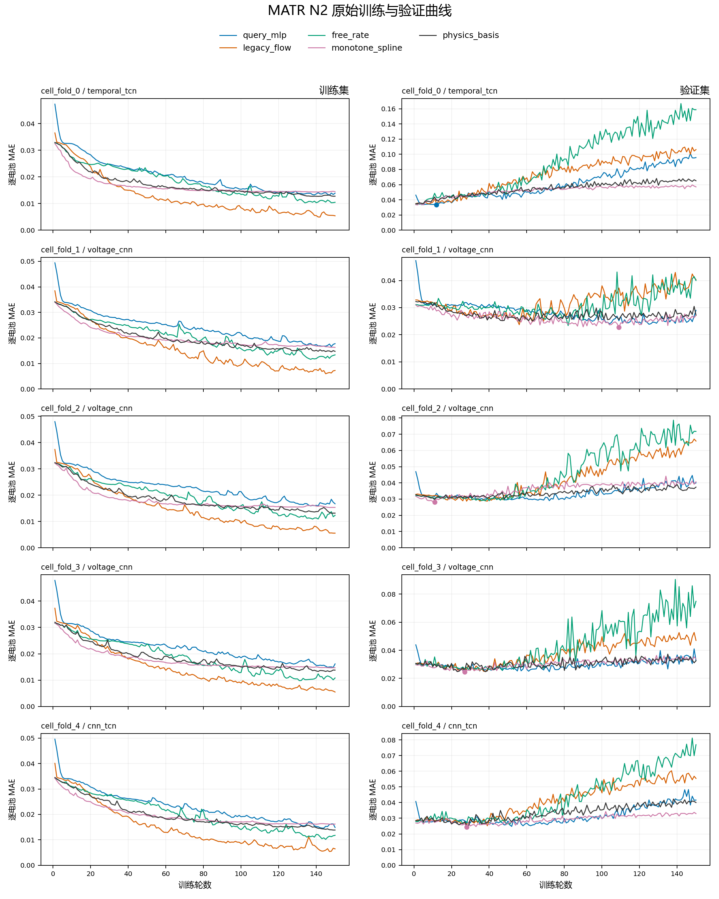
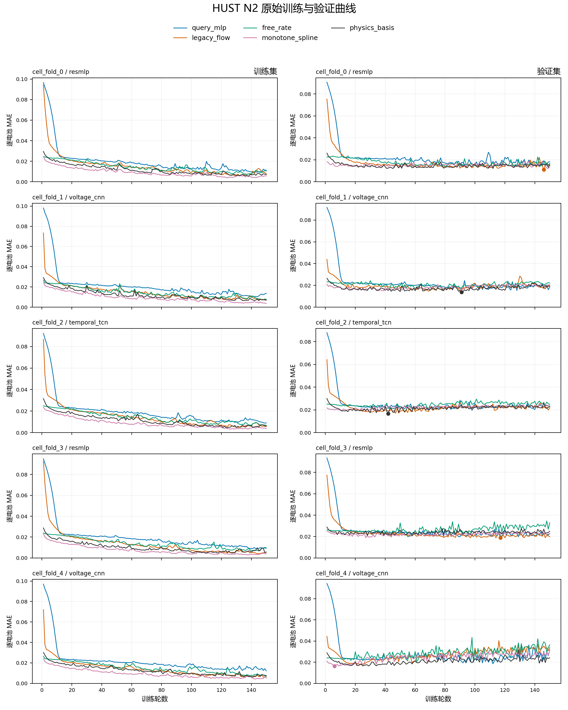

# N2 固定折内编码器结构的五种解码器比较

本轮登记日期为2026-11-16，沿用用户直接要求的seed42。全部MATR169和HUST77分别进行单域五折实验。每组150轮、batch8、宽度64、AdamW学习率0.0003、weight decay0.01、梯度裁剪1.0。损失为完整实际观测后缀逐电池等权MAE，选权遵循本折内部验证MAE的strict first-min。所有曲线保留原始150轮，源数据和划分在训练前封存。

MATR拥有123,431个未来观测，HUST拥有138,422个。全部未来观测均保持原始周期与mask，窗口支持不足时记录缺失。SOH使用1.1Ah名义容量归一化，SOH100锚点采用真实96–100圈有效容量中位数。每域分别拟合训练电池的有效点标准化。两域的物理电压窗口和策略维数保持各自定义。

所有队列均有历史研究暴露，本轮属于内部回顾性验证。单种子无法估计训练种子方差。bootstrap区间为当前拟合预测上的条件区间，进行了多个预登记探索性比较。HUST77个精确协议各只有一颗电池，协议重采样缺少组内重复支持。

N2固定每外折N1选出的编码器结构，从头训练各个新解码器。query_mlp复用相同折N1已经从头训练的同配置产物。每域新增20组解码器训练，共享5组query_mlp基线，不复用历史SR-111模型权重。N1 nested与N2 query_mlp逐电池预测一致。

query_mlp直接预测查询条件修正，legacy_flow为独立解析松弛风格，free_rate为非负速率固定整数周期积分，monotone_spline为十段正速率积分的指数映射，physics_basis为对数自限制、线性及平滑激活三项累计函数的指数映射。全部算子由新n012模块独立实现。physics_basis与monotone_spline的数学形状对照用于约束解释，三项函数的存在尚不足以认证LLI、LAM或SEI。

## 完整未来轨迹

| domain | method | cell_mean_mae | cell_mean_rmse | protocol_macro_mae | protocol_macro_rmse | supported_cells | observations | min_parameters | max_parameters |
| --- | --- | --- | --- | --- | --- | --- | --- | --- | --- |
| HUST | free_rate | 0.022357852 | 0.030762474 | 0.022357852 | 0.030762474 | 77 | 138422 | 43906 | 87682 |
| HUST | legacy_flow | 0.021130968 | 0.028667085 | 0.021130968 | 0.028667085 | 77 | 138422 | 42321 | 86097 |
| HUST | monotone_spline | 0.020499566 | 0.028370422 | 0.020499566 | 0.028370422 | 77 | 138422 | 42378 | 86154 |
| HUST | nested | 0.021823651 | 0.029530853 | 0.021823651 | 0.029530853 | 77 | 138422 | 42321 | 85766 |
| HUST | physics_basis | 0.021837201 | 0.029912052 | 0.021837201 | 0.029912052 | 77 | 138422 | 41990 | 85766 |
| HUST | query_mlp | 0.023898472 | 0.032261011 | 0.023898472 | 0.032261011 | 77 | 138422 | 43905 | 87681 |
| MATR | free_rate | 0.030537582 | 0.051591350 | 0.029462027 | 0.048744854 | 169 | 123431 | 52242 | 104466 |
| MATR | legacy_flow | 0.029370112 | 0.048725683 | 0.028460796 | 0.046082785 | 169 | 123431 | 50657 | 102881 |
| MATR | monotone_spline | 0.030074836 | 0.049478148 | 0.030146012 | 0.048508045 | 169 | 123431 | 50714 | 102938 |
| MATR | nested | 0.030331802 | 0.050474194 | 0.030739376 | 0.049736001 | 169 | 123431 | 50714 | 102938 |
| MATR | physics_basis | 0.030426144 | 0.051521260 | 0.029961871 | 0.049326179 | 169 | 123431 | 50326 | 102550 |
| MATR | query_mlp | 0.030660366 | 0.051671412 | 0.030226917 | 0.049618942 | 169 | 123431 | 52241 | 104465 |

## 折内验证选择

| domain | fold | selected_encoder | N1_validation_mae | selected_decoder | N2_validation_mae |
| --- | --- | --- | --- | --- | --- |
| MATR | cell_fold_0 | temporal_tcn | 0.033303366 | query_mlp | 0.033303366 |
| MATR | cell_fold_1 | voltage_cnn | 0.023864369 | monotone_spline | 0.022748777 |
| MATR | cell_fold_2 | voltage_cnn | 0.029031924 | monotone_spline | 0.028171583 |
| MATR | cell_fold_3 | voltage_cnn | 0.024773593 | monotone_spline | 0.024516865 |
| MATR | cell_fold_4 | cnn_tcn | 0.024813407 | monotone_spline | 0.024277942 |
| HUST | cell_fold_0 | resmlp | 0.014405510 | legacy_flow | 0.010997779 |
| HUST | cell_fold_1 | voltage_cnn | 0.015350718 | physics_basis | 0.013786779 |
| HUST | cell_fold_2 | temporal_tcn | 0.019631466 | physics_basis | 0.016698857 |
| HUST | cell_fold_3 | resmlp | 0.019888294 | legacy_flow | 0.018791107 |
| HUST | cell_fold_4 | voltage_cnn | 0.018538763 | monotone_spline | 0.016268401 |

选择在候选测试评分之前封存。正式all入口先封存该域N1与N2选择，再统一产生测试预测。nested是各折自身验证选择构成的OOF方法，逐电池合并等权汇总。

## 四时距与有效分母

| domain | method | window | cell_mean_mae | cell_mean_rmse | protocol_macro_mae | supported_cells | supported_protocols | observations |
| --- | --- | --- | --- | --- | --- | --- | --- | --- |
| HUST | free_rate | 1001_plus | 0.039650658 | 0.044172892 | 0.039650658 | 77 | 77 | 69122 |
| HUST | free_rate | 101_200 | 0.001506254 | 0.001678651 | 0.001506254 | 77 | 77 | 7700 |
| HUST | free_rate | 201_500 | 0.004725585 | 0.005034016 | 0.004725585 | 77 | 77 | 23100 |
| HUST | free_rate | 501_1000 | 0.012052940 | 0.012893090 | 0.012052940 | 77 | 77 | 38500 |
| HUST | legacy_flow | 1001_plus | 0.038071238 | 0.041549997 | 0.038071238 | 77 | 77 | 69122 |
| HUST | legacy_flow | 101_200 | 0.001636298 | 0.001824843 | 0.001636298 | 77 | 77 | 7700 |
| HUST | legacy_flow | 201_500 | 0.004264985 | 0.004429677 | 0.004264985 | 77 | 77 | 23100 |
| HUST | legacy_flow | 501_1000 | 0.010301623 | 0.011548496 | 0.010301623 | 77 | 77 | 38500 |
| HUST | monotone_spline | 1001_plus | 0.037797981 | 0.041334677 | 0.037797981 | 77 | 77 | 69122 |
| HUST | monotone_spline | 101_200 | 0.001112120 | 0.001223362 | 0.001112120 | 77 | 77 | 7700 |
| HUST | monotone_spline | 201_500 | 0.003076676 | 0.003275895 | 0.003076676 | 77 | 77 | 23100 |
| HUST | monotone_spline | 501_1000 | 0.009845165 | 0.011083442 | 0.009845165 | 77 | 77 | 38500 |
| HUST | nested | 1001_plus | 0.039829967 | 0.042856023 | 0.039829967 | 77 | 77 | 69122 |
| HUST | nested | 101_200 | 0.000991406 | 0.001117200 | 0.000991406 | 77 | 77 | 7700 |
| HUST | nested | 201_500 | 0.003323996 | 0.003526128 | 0.003323996 | 77 | 77 | 23100 |
| HUST | nested | 501_1000 | 0.010420803 | 0.011535662 | 0.010420803 | 77 | 77 | 38500 |
| HUST | physics_basis | 1001_plus | 0.040148400 | 0.043688341 | 0.040148400 | 77 | 77 | 69122 |
| HUST | physics_basis | 101_200 | 0.000996812 | 0.001109265 | 0.000996812 | 77 | 77 | 7700 |
| HUST | physics_basis | 201_500 | 0.003342571 | 0.003578909 | 0.003342571 | 77 | 77 | 23100 |
| HUST | physics_basis | 501_1000 | 0.011096271 | 0.012221828 | 0.011096271 | 77 | 77 | 38500 |
| HUST | query_mlp | 1001_plus | 0.041782564 | 0.046189117 | 0.041782564 | 77 | 77 | 69122 |
| HUST | query_mlp | 101_200 | 0.001730989 | 0.001932488 | 0.001730989 | 77 | 77 | 7700 |
| HUST | query_mlp | 201_500 | 0.005649266 | 0.005983401 | 0.005649266 | 77 | 77 | 23100 |
| HUST | query_mlp | 501_1000 | 0.013323361 | 0.014236796 | 0.013323361 | 77 | 77 | 38500 |
| MATR | free_rate | 1001_plus | 0.093851571 | 0.097912681 | 0.101782043 | 40 | 19 | 10614 |
| MATR | free_rate | 101_200 | 0.002519327 | 0.002914667 | 0.003277841 | 169 | 77 | 16865 |
| MATR | free_rate | 201_500 | 0.015511191 | 0.020531809 | 0.021412005 | 168 | 76 | 49795 |
| MATR | free_rate | 501_1000 | 0.071356854 | 0.083274627 | 0.087495886 | 151 | 61 | 46157 |
| MATR | legacy_flow | 1001_plus | 0.091915271 | 0.095273533 | 0.099289432 | 40 | 19 | 10614 |
| MATR | legacy_flow | 101_200 | 0.002655971 | 0.003030057 | 0.003414368 | 169 | 77 | 16865 |
| MATR | legacy_flow | 201_500 | 0.014495978 | 0.019529008 | 0.020833464 | 168 | 76 | 49795 |
| MATR | legacy_flow | 501_1000 | 0.068066800 | 0.078797270 | 0.081260580 | 151 | 61 | 46157 |
| MATR | monotone_spline | 1001_plus | 0.079409968 | 0.082751279 | 0.084667735 | 40 | 19 | 10614 |
| MATR | monotone_spline | 101_200 | 0.002849330 | 0.003278289 | 0.003938844 | 169 | 77 | 16865 |
| MATR | monotone_spline | 201_500 | 0.016323889 | 0.021614320 | 0.023785720 | 168 | 76 | 49795 |
| MATR | monotone_spline | 501_1000 | 0.071676353 | 0.082351103 | 0.087931324 | 151 | 61 | 46157 |
| MATR | nested | 1001_plus | 0.084595446 | 0.088353538 | 0.092020540 | 40 | 19 | 10614 |
| MATR | nested | 101_200 | 0.002731836 | 0.003149614 | 0.003813415 | 169 | 77 | 16865 |
| MATR | nested | 201_500 | 0.016255481 | 0.021561498 | 0.024025424 | 168 | 76 | 49795 |
| MATR | nested | 501_1000 | 0.072553536 | 0.083611113 | 0.089795793 | 151 | 61 | 46157 |
| MATR | physics_basis | 1001_plus | 0.090317366 | 0.093955067 | 0.096728354 | 40 | 19 | 10614 |
| MATR | physics_basis | 101_200 | 0.002649146 | 0.003049719 | 0.003548676 | 169 | 77 | 16865 |
| MATR | physics_basis | 201_500 | 0.015977641 | 0.021217902 | 0.022817635 | 168 | 76 | 49795 |
| MATR | physics_basis | 501_1000 | 0.071079219 | 0.083082984 | 0.086524051 | 151 | 61 | 46157 |
| MATR | query_mlp | 1001_plus | 0.095333926 | 0.099167837 | 0.105828068 | 40 | 19 | 10614 |
| MATR | query_mlp | 101_200 | 0.002470130 | 0.002866310 | 0.003273231 | 169 | 77 | 16865 |
| MATR | query_mlp | 201_500 | 0.015651066 | 0.020733247 | 0.022147746 | 168 | 76 | 49795 |
| MATR | query_mlp | 501_1000 | 0.071039727 | 0.082896811 | 0.087063042 | 151 | 61 | 46157 |

MATR在1001圈后有40颗轨迹支持，HUST在该窗口有77颗。此支持与早期输入资格分别记录，缺少远期观测的电池仍保留在完整后缀任务中。

## 预登记配对比较

| domain | metric | candidate | reference | sampling_unit | improvement | ci95_low | ci95_high | better_cells | worse_cells | paired_cells |
| --- | --- | --- | --- | --- | --- | --- | --- | --- | --- | --- |
| HUST | mae | N2:legacy_flow | N2:query_mlp | cell | 0.002767503 | 0.000734194 | 0.004866692 | 43 | 34 | 77 |
| HUST | mae | N2:legacy_flow | N2:query_mlp | protocol_group | 0.002767503 | 0.000760189 | 0.004973194 | 43 | 34 | 77 |
| HUST | mae | N2:free_rate | N2:query_mlp | cell | 0.001540620 | -0.000747821 | 0.004119633 | 39 | 38 | 77 |
| HUST | mae | N2:free_rate | N2:query_mlp | protocol_group | 0.001540620 | -0.000811546 | 0.004164263 | 39 | 38 | 77 |
| HUST | mae | N2:monotone_spline | N2:query_mlp | cell | 0.003398906 | 0.001265862 | 0.005600596 | 48 | 29 | 77 |
| HUST | mae | N2:monotone_spline | N2:query_mlp | protocol_group | 0.003398906 | 0.001263459 | 0.005700332 | 48 | 29 | 77 |
| HUST | mae | N2:physics_basis | N2:query_mlp | cell | 0.002061271 | -0.000028301 | 0.004488427 | 46 | 31 | 77 |
| HUST | mae | N2:physics_basis | N2:query_mlp | protocol_group | 0.002061271 | -0.000025733 | 0.004421401 | 46 | 31 | 77 |
| HUST | mae | N2:physics_basis | N2:free_rate | cell | 0.000520651 | -0.002387911 | 0.003032508 | 42 | 35 | 77 |
| HUST | mae | N2:physics_basis | N2:free_rate | protocol_group | 0.000520651 | -0.002541489 | 0.003275290 | 42 | 35 | 77 |
| HUST | mae | N2:physics_basis | N2:monotone_spline | cell | -0.001337635 | -0.003611873 | 0.000796151 | 34 | 43 | 77 |
| HUST | mae | N2:physics_basis | N2:monotone_spline | protocol_group | -0.001337635 | -0.003661991 | 0.000938047 | 34 | 43 | 77 |
| HUST | rmse | N2:legacy_flow | N2:query_mlp | cell | 0.003593926 | 0.001028265 | 0.006190850 | 49 | 28 | 77 |
| HUST | rmse | N2:legacy_flow | N2:query_mlp | protocol_group | 0.003593926 | 0.001075022 | 0.006313492 | 49 | 28 | 77 |
| HUST | rmse | N2:free_rate | N2:query_mlp | cell | 0.001498537 | -0.001246000 | 0.004443338 | 37 | 40 | 77 |
| HUST | rmse | N2:free_rate | N2:query_mlp | protocol_group | 0.001498537 | -0.001282802 | 0.004546600 | 37 | 40 | 77 |
| HUST | rmse | N2:monotone_spline | N2:query_mlp | cell | 0.003890589 | 0.001182685 | 0.006588451 | 50 | 27 | 77 |
| HUST | rmse | N2:monotone_spline | N2:query_mlp | protocol_group | 0.003890589 | 0.001290812 | 0.006621876 | 50 | 27 | 77 |
| HUST | rmse | N2:physics_basis | N2:query_mlp | cell | 0.002348959 | -0.000298851 | 0.005144494 | 44 | 33 | 77 |
| HUST | rmse | N2:physics_basis | N2:query_mlp | protocol_group | 0.002348959 | -0.000162420 | 0.005247612 | 44 | 33 | 77 |
| HUST | rmse | N2:physics_basis | N2:free_rate | cell | 0.000850422 | -0.002852076 | 0.004100576 | 43 | 34 | 77 |
| HUST | rmse | N2:physics_basis | N2:free_rate | protocol_group | 0.000850422 | -0.003055839 | 0.004372963 | 43 | 34 | 77 |
| HUST | rmse | N2:physics_basis | N2:monotone_spline | cell | -0.001541630 | -0.004514185 | 0.001366368 | 36 | 41 | 77 |
| HUST | rmse | N2:physics_basis | N2:monotone_spline | protocol_group | -0.001541630 | -0.004526179 | 0.001491612 | 36 | 41 | 77 |
| MATR | mae | N2:legacy_flow | N2:query_mlp | cell | 0.001290254 | -0.000370082 | 0.002980259 | 99 | 70 | 169 |
| MATR | mae | N2:legacy_flow | N2:query_mlp | protocol_group | 0.001766121 | -0.000578568 | 0.004132366 | 99 | 70 | 169 |
| MATR | mae | N2:free_rate | N2:query_mlp | cell | 0.000122784 | -0.001049116 | 0.001249442 | 82 | 87 | 169 |
| MATR | mae | N2:free_rate | N2:query_mlp | protocol_group | 0.000764890 | -0.000840780 | 0.002388088 | 82 | 87 | 169 |
| MATR | mae | N2:monotone_spline | N2:query_mlp | cell | 0.000585530 | -0.001013480 | 0.002205642 | 93 | 76 | 169 |
| MATR | mae | N2:monotone_spline | N2:query_mlp | protocol_group | 0.000080905 | -0.001647708 | 0.001610363 | 93 | 76 | 169 |
| MATR | mae | N2:physics_basis | N2:query_mlp | cell | 0.000234222 | -0.001488374 | 0.002069419 | 83 | 86 | 169 |
| MATR | mae | N2:physics_basis | N2:query_mlp | protocol_group | 0.000265046 | -0.001568377 | 0.002285358 | 83 | 86 | 169 |
| MATR | mae | N2:physics_basis | N2:free_rate | cell | 0.000111438 | -0.001325248 | 0.001807348 | 85 | 84 | 169 |
| MATR | mae | N2:physics_basis | N2:free_rate | protocol_group | -0.000499844 | -0.002090218 | 0.001150023 | 85 | 84 | 169 |
| MATR | mae | N2:physics_basis | N2:monotone_spline | cell | -0.000351308 | -0.001967755 | 0.001264910 | 76 | 93 | 169 |
| MATR | mae | N2:physics_basis | N2:monotone_spline | protocol_group | 0.000184141 | -0.001227260 | 0.001703184 | 76 | 93 | 169 |
| MATR | mae | N2:query_mlp | HISTORICAL:M1 | cell | -0.011898402 | -0.014627287 | -0.009270512 | 27 | 142 | 169 |
| MATR | mae | N2:query_mlp | HISTORICAL:M1 | protocol_group | -0.013238135 | -0.016351503 | -0.010121767 | 27 | 142 | 169 |
| MATR | mae | N2:legacy_flow | HISTORICAL:M1 | cell | -0.010608148 | -0.013410161 | -0.007928469 | 35 | 134 | 169 |
| MATR | mae | N2:legacy_flow | HISTORICAL:M1 | protocol_group | -0.011472014 | -0.014864407 | -0.008138937 | 35 | 134 | 169 |
| MATR | mae | N2:free_rate | HISTORICAL:M1 | cell | -0.011775618 | -0.014757113 | -0.009131630 | 32 | 137 | 169 |
| MATR | mae | N2:free_rate | HISTORICAL:M1 | protocol_group | -0.012473245 | -0.015801196 | -0.009272977 | 32 | 137 | 169 |
| MATR | mae | N2:monotone_spline | HISTORICAL:M1 | cell | -0.011312872 | -0.014077461 | -0.008680028 | 37 | 132 | 169 |
| MATR | mae | N2:monotone_spline | HISTORICAL:M1 | protocol_group | -0.013157230 | -0.016203886 | -0.010317387 | 37 | 132 | 169 |
| MATR | mae | N2:physics_basis | HISTORICAL:M1 | cell | -0.011664180 | -0.014493284 | -0.009078872 | 34 | 135 | 169 |
| MATR | mae | N2:physics_basis | HISTORICAL:M1 | protocol_group | -0.012973089 | -0.016043784 | -0.010140631 | 34 | 135 | 169 |
| MATR | mae | N2:nested | HISTORICAL:M1 | cell | -0.011569838 | -0.014387349 | -0.008883404 | 37 | 132 | 169 |
| MATR | mae | N2:nested | HISTORICAL:M1 | protocol_group | -0.013750593 | -0.016833946 | -0.010830644 | 37 | 132 | 169 |
| MATR | rmse | N2:legacy_flow | N2:query_mlp | cell | 0.002945729 | 0.000620908 | 0.005268046 | 109 | 60 | 169 |
| MATR | rmse | N2:legacy_flow | N2:query_mlp | protocol_group | 0.003536157 | 0.000445954 | 0.006374664 | 109 | 60 | 169 |
| MATR | rmse | N2:free_rate | N2:query_mlp | cell | 0.000080063 | -0.001491924 | 0.001620366 | 93 | 76 | 169 |
| MATR | rmse | N2:free_rate | N2:query_mlp | protocol_group | 0.000874088 | -0.001146008 | 0.002886720 | 93 | 76 | 169 |
| MATR | rmse | N2:monotone_spline | N2:query_mlp | cell | 0.002193264 | -0.000138986 | 0.004583740 | 104 | 65 | 169 |
| MATR | rmse | N2:monotone_spline | N2:query_mlp | protocol_group | 0.001110897 | -0.001296848 | 0.003216716 | 104 | 65 | 169 |
| MATR | rmse | N2:physics_basis | N2:query_mlp | cell | 0.000150153 | -0.002094937 | 0.002483905 | 92 | 77 | 169 |
| MATR | rmse | N2:physics_basis | N2:query_mlp | protocol_group | 0.000292763 | -0.002049679 | 0.002821286 | 92 | 77 | 169 |
| MATR | rmse | N2:physics_basis | N2:free_rate | cell | 0.000070090 | -0.002055838 | 0.002567949 | 87 | 82 | 169 |
| MATR | rmse | N2:physics_basis | N2:free_rate | protocol_group | -0.000581325 | -0.002762193 | 0.001695955 | 87 | 82 | 169 |
| MATR | rmse | N2:physics_basis | N2:monotone_spline | cell | -0.002043112 | -0.004452671 | 0.000487378 | 65 | 104 | 169 |
| MATR | rmse | N2:physics_basis | N2:monotone_spline | protocol_group | -0.000818134 | -0.002709974 | 0.001170423 | 65 | 104 | 169 |
| MATR | rmse | N2:query_mlp | HISTORICAL:M1 | cell | -0.020092866 | -0.024250656 | -0.016181190 | 27 | 142 | 169 |
| MATR | rmse | N2:query_mlp | HISTORICAL:M1 | protocol_group | -0.022868599 | -0.027349543 | -0.018320192 | 27 | 142 | 169 |
| MATR | rmse | N2:legacy_flow | HISTORICAL:M1 | cell | -0.017147137 | -0.021200135 | -0.013209881 | 34 | 135 | 169 |
| MATR | rmse | N2:legacy_flow | HISTORICAL:M1 | protocol_group | -0.019332442 | -0.024099927 | -0.014660640 | 34 | 135 | 169 |
| MATR | rmse | N2:free_rate | HISTORICAL:M1 | cell | -0.020012803 | -0.024336265 | -0.015851617 | 27 | 142 | 169 |
| MATR | rmse | N2:free_rate | HISTORICAL:M1 | protocol_group | -0.021994511 | -0.026733668 | -0.017307071 | 27 | 142 | 169 |
| MATR | rmse | N2:monotone_spline | HISTORICAL:M1 | cell | -0.017899602 | -0.022183447 | -0.013783137 | 30 | 139 | 169 |
| MATR | rmse | N2:monotone_spline | HISTORICAL:M1 | protocol_group | -0.021757702 | -0.026625711 | -0.017248048 | 30 | 139 | 169 |
| MATR | rmse | N2:physics_basis | HISTORICAL:M1 | cell | -0.019942713 | -0.024096021 | -0.016026272 | 28 | 141 | 169 |
| MATR | rmse | N2:physics_basis | HISTORICAL:M1 | protocol_group | -0.022575837 | -0.027165736 | -0.018091496 | 28 | 141 | 169 |
| MATR | rmse | N2:nested | HISTORICAL:M1 | cell | -0.018895648 | -0.023208937 | -0.014695803 | 29 | 140 | 169 |
| MATR | rmse | N2:nested | HISTORICAL:M1 | protocol_group | -0.022985658 | -0.027987272 | -0.018326964 | 29 | 140 | 169 |

改善量为参照误差减候选误差，正值支持候选。区间使用2,000次seed42条件重采样，分别按电池和协议组。全部候选及阴性结果保留。

## 历史M1参照

| domain | cell_mean_mae | cell_mean_rmse | supported_cells | observations |
| --- | --- | --- | --- | --- |
| MATR | 0.018761964 | 0.031578546 | 169 | 123431 |

MATR历史M1使用相同169颗电池、原五折和实际后缀，原观测与预测逐值核对。其额外global/local物理统计、观测残差、SOH边界及速率辅助损失与本轮存在差异，结果反映整个方法的历史比较。HUST单域结果没有混入MATR均值。

## 原始训练与验证曲线

圆点表示最终验证选定的候选及其选权轮数。坐标使用SOH fraction，曲线没有平滑或重排。

## 优势与风险

优势为完整队列、独立结构、固定预算及折内验证选模可复核。风险包括参数量不匹配、历史暴露、单种子、HUST协议单例，以及全轨迹误差对不同时距的混合。数值复核置信度高，跨种子与外部泛化置信度低。

## 拓展思考

同一方法的总体误差与后期窗口误差需要结合实际支持数解释。

## 你可能想知道

完整逐电池和逐协议误差、训练时间与权重来源位于results/N012_independent/analysis，全部选定权重及恢复状态随结果目录交付。
