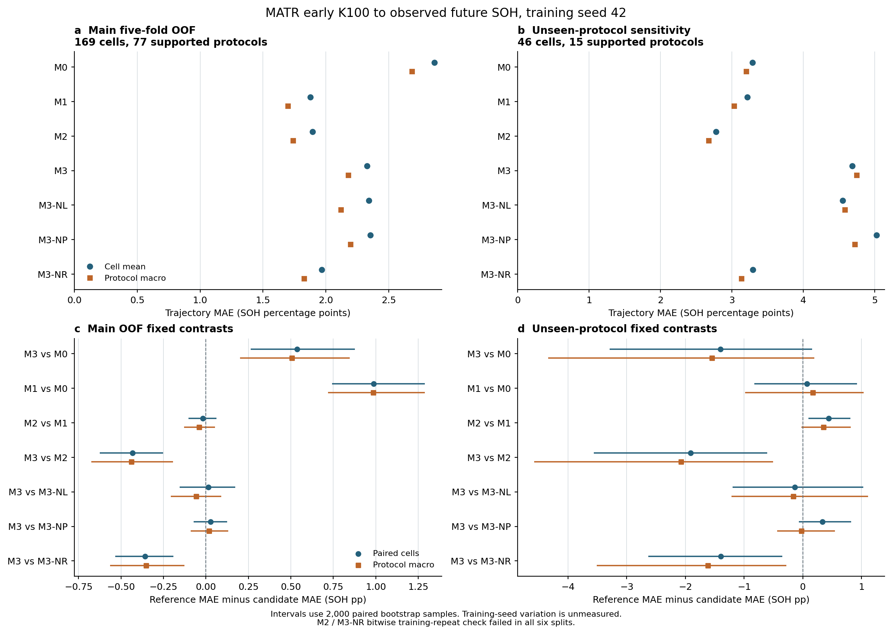
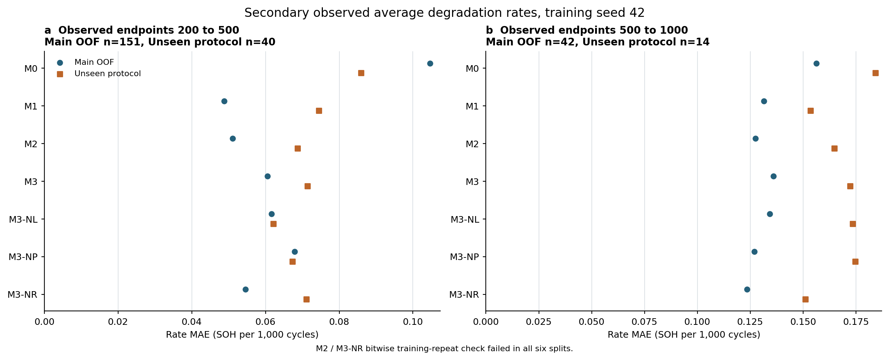

# MATR统一研究合同单种子42实验

## 执行范围与实际状态

本轮按用户要求仅运行训练种子42。固定MATR169颗LFP/石墨电芯，输入为真实老化循环1–100的合格放电VIQ、前缀物理响应特征和预测时已知快充协议。主目标为全部实际可观测未来SOH轨迹，SOH主口径为设备放电容量除以标称1.1 Ah。

七组模型各完成五折电芯互斥交叉验证及一次未见协议敏感性分析，共42个训练单元、6300个epoch、87150次正式优化器更新。所有单元跑满150轮，依据验证集cell-mean轨迹MAE的首次最小值选择权重。五折主OOF覆盖169颗、77个协议及123431个实际观测点，协议敏感性覆盖46颗、15个协议及38312点。

**完整矩阵已经执行，分析状态为`ANALYZED_WITH_REPRODUCTION_FAILURE`。M2与M3-NR的预期逐值训练复现通过0/6。** 正式结果、所有失败标记和原始训练状态均保留，结果图同步标注这一限制。

## 全轨迹结果

下表MAE与RMSE均先在每颗电芯实际可观测未来上计算，再对电芯等权平均，单位为SOH比例。

| 模型 | 主OOF MAE | 主OOF RMSE | 主OOF协议宏MAE | 未见协议MAE |
|---|---:|---:|---:|---:|
| M0 | 0.028632 | 0.046918 | 0.026849 | 0.032889 |
| M1 | 0.018762 | 0.031579 | 0.016989 | 0.032188 |
| M2 | 0.018946 | 0.031923 | 0.017390 | 0.027803 |
| M3 | 0.023268 | 0.037955 | 0.021777 | 0.046896 |
| M3-NL | 0.023414 | 0.038991 | 0.021203 | 0.045554 |
| M3-NP | 0.023540 | 0.038847 | 0.021965 | 0.050259 |
| M3-NR | 0.019671 | 0.032409 | 0.018264 | 0.032938 |

主OOF的M1相对M0 MAE降低34.47%，M3相对M0降低18.73%。M3相对M2 MAE增加22.82%，相对M3-NR增加18.28%。未见协议敏感性中，M3相对M0 MAE增加42.59%，相对M2增加68.68%。这些百分比由对应cell-mean误差比值计算。

## 固定消融与三个Insight

下表保留全部七个主OOF固定对照。正的MAE降低值对应候选误差更低，区间采用2000次seed42配对电芯bootstrap。各协议等权宏平均的配对区间与逐协议支持保存在完整分析表中。

| 对照 | MAE降低 | 电芯95%区间 | 协议宏95%区间 |
|---|---:|---|---|
| M3相对M0 | 0.005364 | [0.002643, 0.008770] | [0.002002, 0.008459] |
| M1相对M0 | 0.009870 | [0.007432, 0.012896] | [0.007191, 0.012893] |
| M2相对M1 | -0.000184 | [-0.001026, 0.000623] | [-0.001293, 0.000542] |
| M3相对M2 | -0.004323 | [-0.006261, -0.002523] | [-0.006761, -0.001929] |
| M3相对M3-NL | 0.000145 | [-0.001547, 0.001718] | [-0.002069, 0.000894] |
| M3相对M3-NP | 0.000272 | [-0.000720, 0.001254] | [-0.000888, 0.001319] |
| M3相对M3-NR | -0.003597 | [-0.005338, -0.001915] | [-0.005639, -0.001277] |

- 普通物理融合M1在当前主OOF上具有正向误差改善。它同时增加物理输入与编码参数，特定分解量的独立贡献仍需按固定消融解释。
- Insight1对应M3与M3-NL，电芯及协议区间均跨0。NL仅保留全局输入，删除raw/reference VIQ数值及全部local信息，原曲线中的电流数值也随之移除。当前比较支持的局部增量证据有限。
- Insight2对应M2与M1、M3与M3-NP，主OOF区间均跨0。协议敏感性的M2相对M1改善，电芯区间为[0.000927, 0.008079]，协议宏区间跨0，跨协议持续性收益证据仍有限。
- Insight3对应M3与M2、M3与M3-NR，主OOF和协议敏感性误差均较高。当前结果未建立速率积分Flow的性能优势。

M2与M3-NR共享理论计算图与初值，两项对应消融具有重复设计关系。实际训练分岔需要作为执行复现限制处理，两项比较的证据相关。

## 次指标与有效分母

下表速率MAE单位为SOH/1000圈。主OOF的两段速率支持分别151和42颗，未见协议分别40和14颗。主队列继续保留全部169颗。

| 模型 | 主200–500 | 主500–1000 | 协议200–500 | 协议500–1000 | 主EOL C | 协议EOL C |
|---|---:|---:|---:|---:|---:|---:|
| M0 | 0.104593 | 0.156351 | 0.085889 | 0.184231 | 0.698956 | 0.604651 |
| M1 | 0.048799 | 0.131430 | 0.074461 | 0.153565 | 0.861133 | 0.838178 |
| M2 | 0.051052 | 0.127452 | 0.068737 | 0.164822 | 0.859228 | 0.843023 |
| M3 | 0.060511 | 0.136037 | 0.071401 | 0.172239 | 0.824882 | 0.827519 |
| M3-NL | 0.061649 | 0.134314 | 0.062151 | 0.173555 | 0.810847 | 0.751938 |
| M3-NP | 0.067856 | 0.126959 | 0.067319 | 0.174746 | 0.828902 | 0.835271 |
| M3-NR | 0.054542 | 0.123584 | 0.071058 | 0.151180 | 0.853798 | 0.850775 |

速率由共同观测预测的精确端点之差计算，属于预先登记的训练辅助目标。EOL C衡量预设cycle5000查询范围内趋势首次越过0.8的排序表现。其解释范围是排序一致性。主队列实际事件169、右删失0，协议敏感性事件46、右删失0，可比较对分别14179和1032。当前数据未提供真实删失场景的实证覆盖。

完整四时距表显示，主OOF在101–200、201–500、501–1000、1001以后分别支持169、168、151、40颗，协议敏感性分别支持46、45、40、14颗。M3在未见协议1001以后MAE为0.203190，M2为0.111613，该范围分母为14颗。

## 两项实现与复现限制

合同F2明确保留旧解析Flow强基线，F3文字同时要求单调不可逆趋势。实际注册实现中，M3、M3-NL和M3-NP通过非负速率积分保证结构性单调，M0、M1、M2和M3-NR保留旧解析式，decoder未对时间导数符号施加结构性约束。F3的共同单调趋势文字要求与F2保留旧解析Flow的注册基线存在实现口径冲突，当前四个旧Flow组未强制结构性单调。观测层统一使用0.03幅度残差及[0,1.2]范围，观测波动与趋势单调应分别解释。

M2与M3-NR六个划分的初始state SHA、角色、训练配置、更新预算及训练标准化参数全部逐值一致。首epoch验证MAE差异约6.1e-11至4.2e-10，随后训练和选权产生分岔，六个划分均未满足预期逐值复现。初期微差的执行根因尚待独立证据认证。分析中的`duplicate_reproduction.csv`保留全部false细项，原始选中权重和最终可恢复训练状态均封存。

首训练batch的独立工程诊断恢复同一CPU/CUDA RNG，比较同一M2实例、第二个M2实例与M3-NR，三项比较的全部forward输出、损失项和89组参数梯度均逐值相同，最大梯度差0。该诊断执行0次优化器更新，覆盖第一批前向与反向，整程训练复现仍维持0/6。实测记录见[复现诊断](../results/unified_matr_seed42/REPRODUCTION_DIAGNOSTIC.json)，其范围无法认证后续分岔根因。

按每颗电芯实际观测的相邻真实查询统计，主OOF共123262对，未见协议共38266对。下表计数采用严格正的趋势增量，数值容差1e-6的另一份统计保存在逐电芯核验记录中。

| 模型 | 主OOF上升邻对 | 主OOF有上升电芯 | 协议上升邻对 | 协议有上升电芯 |
|---|---:|---:|---:|---:|
| M0 | 19103 | 169/169 | 3516 | 46/46 |
| M1 | 2313 | 45/169 | 256 | 17/46 |
| M2 | 0 | 0/169 | 2429 | 31/46 |
| M3 | 0 | 0/169 | 0 | 0/46 |
| M3-NL | 0 | 0/169 | 0 | 0/46 |
| M3-NP | 0 | 0/169 | 0 | 0/46 |
| M3-NR | 1889 | 26/169 | 3 | 1/46 |

M0主OOF最大相邻趋势上升为0.000403643 SOH。上述实测覆盖clamp后的已观测查询范围，正速率积分组的结构性性质由其数学公式及模型工程检查共同支持。

## 独立结果核验

独立验证状态为`VERIFIED_WITH_REPRODUCTION_FAILURE`，共1603项记录，1597项PASS与6项已知重复失配，新增硬失败为0。全部42个选中模型通过正常CUDA入口重放验证集、测试轨迹、速率端点和EOL，测试轨迹最大绝对差为0.0。训练和统计核验分别确认150轮、87150次更新、18060条cell-metric记录、336条常规对照及28条EOL对照。

主OOF、协议敏感性、四个时距、两段速率、EOL、配对bootstrap及CSV/JSON汇总均经独立统计算术重算。问题清单包含3899条缺支持记录、6607条负向电芯对照及6条重复失配警告。选中权重的模型推理沿用注册实现，统计重算使用独立代码。历史未逐份保存的epoch权重未进行逐epoch重放。

完整回执位于[独立科学核验](../results/unified_matr_seed42/FINAL_SCIENTIFIC_VERIFICATION.json)，SHA256为`be9943576720c415ae40c3f066c0999a5cc737b185ce1fb51961ce573f4c324d`。

## 数据来源与工程决定

完整174份原始CSV、174份Arbin Metadata与174份控制协议均已恢复和审计。数据冻结580项检查通过，并在实际训练loader加载核验后绑定44个文件。源处理保留设备ID前导零、跨批同一电芯、真实循环间隔、b1c18后续表征身份以及字段级时钟异常。6780条合格主放电记录存在原生Step标签字面编号例外，涉及111颗和386条前缀记录，其电学计量条件通过。其中3条原生日志例外已完成阶段字段的独立精确重放，控制系统标签偏移的根因尚未认证。

本轮固定的工程取值包括五折、20%验证比例、150轮、batch8、AdamW学习率3e-4、weight decay0.01、前1–10真实圈参考且至少5条合格曲线、SG(5,2)、Huber IRLS、2.8–3.3 V的64点网格、4C放电电流10%容差、1.1 Ah主分母。这些精确数值来自执行前登记的工程选择。七组参数数分别为M0的101901，M1/M2/M3/NP/NR的134301及NL的134331。

正式矩阵累计训练日志计时约3462.65秒，约57.71分钟。该数值覆盖训练单元日志计时范围，来源恢复、全量数据审计和交付另有耗时。公开数据与源码检查点5a8c987发布时，部分正式单元已经评估。其记录类型为数据与源码检查点。训练前的本地数据冻结和运行注册由各项SHA与执行守卫绑定。

## 优势、风险与置信度

优势为真实仪器轴、完整元数据、严格K100前缀与全部可观测未来统一衔接，七组共用信息预算、划分、训练轮数和选权规则，并保留逐电芯、逐协议、负向结果与完整训练状态。

风险包括历史169队列的选择和探索暴露、单seed、未见协议样本有限、旧Flow单调文字口径偏离，以及M2/NR训练重复失败。配对bootstrap以当前固定划分、已拟合seed42预测为条件，训练seed、重新划分和重拟合波动尚未覆盖，各个95%区间没有进行多重比较校正。

当前数值汇总的解释置信度为高，依据为封存预测、完整支持表及独立统计核验。普通物理融合M1的正向改善限于本次主OOF估计，未见协议敏感性的电芯与协议宏区间均跨0。三个结构模块均有稳定独立增益这一命题未获当前结果支持。带载Q(V)分解的物理解释限于数学定义的电学响应，电极级LLI/LAM及特定微观退化模式的认证证据仍缺失。

## 文件与复核入口

完整自动结果、全部对照和分时段表位于[分析报告](../results/unified_matr_seed42/analysis/RESULTS_REPORT_ZH.md)。逐电芯预测、选中权重、可恢复状态和完成证书位于`results/unified_matr_seed42/runs`，506个训练文件的逐字节复制记录位于`RUN_SNAPSHOT.json`。自动报告末尾关于重复一致性的句子描述检查设计，实际通过数以0/6及本报告限制为准。复核及从头执行命令见[复现说明](UNIFIED_MATR_REPRODUCTION_ZH.md)。

用户补充供应数据下载自BatteryLife仓库的processed Zenodo入口，论文附录A.1、官方预处理源码、本地checkout与SDU归档校验值已形成[发布版来源补充](BATTERYLIFE_ZENODO_RELEASE_LINEAGE_ZH.md)。该记录补充供应数据的来源链，主矩阵的冻结派生数据及已保存预测继续由既有SHA绑定。

## 拓展思考

完整M3的主OOF改善同时伴随相对普通物理融合的误差上升，局部残差、持续性和积分结构的证据应分别保留，当前结果支持继续围绕同一科学问题解释正负证据。

## 你可能想知道

保留短寿命电芯使未来监督长度各不相同，每电芯等权主指标减少长轨迹记录数的隐式权重。两段速率和长期时距的支持分母已单独记录，便于核对训练目标与结果的实际信息范围。
