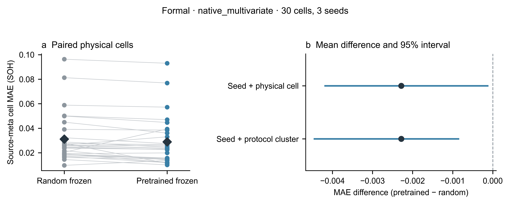

# DRS-PEFT P0 源开发基线与预训练审计

本次状态为**PASSED**，真实执行闭环为`True`。

有效pilot凭据6/6，有效formal凭据12/12。Bridge冻结状态为True，选择为`native_multivariate`。

本报告重新校验每个有效run凭据所列文件SHA、完整训练步数、选权、源码身份、源归一化角色和验证预测NPZ。MAE/RMSE由逐物理电芯的实际观测点重算，再跨电芯等权。源验证标签用于Bridge和checkpoint选择，因此这些误差属于开发集证据。最终目标Query保持SEALED_NOT_EVALUATED。

## 实际完成训练

| 阶段 | Bridge | 方法 | seed | epochs/updates | MAE | RMSE | 工况宏MAE | Bridge/Head/PEFT参数 |
|---|---|---|---:|---|---:|---:|---:|---|
| pilot | native_multivariate | B0_pretrained_frozen | 42 | 60/660 | 0.03181256 | 0.05647343 | 0.02717311 | 56832/6337/0 |
| pilot | native_multivariate | B1_random_frozen | 42 | 60/660 | 0.03319218 | 0.05963735 | 0.02876216 | 56832/6337/0 |
| pilot | native_multivariate | B2_standard_lora | 42 | 60/660 | 0.03195718 | 0.05846833 | 0.02726699 | 56832/6337/36864 |
| pilot | cycle_embedding | B0_pretrained_frozen | 42 | 60/660 | 0.03409636 | 0.06154530 | 0.02957910 | 76256/6337/0 |
| pilot | cycle_embedding | B1_random_frozen | 42 | 60/660 | 0.03623236 | 0.06276042 | 0.03330688 | 76256/6337/0 |
| pilot | cycle_embedding | B2_standard_lora | 42 | 60/660 | 0.03388004 | 0.06123760 | 0.02930517 | 76256/6337/36864 |
| formal | native_multivariate | B0_pretrained_frozen | 42 | 120/1320 | 0.02887484 | 0.05283130 | 0.02369731 | 56832/6337/0 |
| formal | native_multivariate | B1_random_frozen | 42 | 120/1320 | 0.03094600 | 0.05787636 | 0.02636739 | 56832/6337/0 |
| formal | native_multivariate | B2_standard_lora | 42 | 120/1320 | 0.02758363 | 0.04836074 | 0.02264237 | 56832/6337/36864 |
| formal | native_multivariate | B3_battery_direct | 42 | 120/1320 | 0.02599601 | 0.04796491 | 0.02178909 | 125364/6337/0 |
| formal | native_multivariate | B0_pretrained_frozen | 123 | 120/1320 | 0.02860642 | 0.05038481 | 0.02353939 | 56832/6337/0 |
| formal | native_multivariate | B1_random_frozen | 123 | 120/1320 | 0.03064873 | 0.05533070 | 0.02624174 | 56832/6337/0 |
| formal | native_multivariate | B2_standard_lora | 123 | 120/1320 | 0.02588966 | 0.04583987 | 0.02103249 | 56832/6337/36864 |
| formal | native_multivariate | B3_battery_direct | 123 | 120/1320 | 0.02639131 | 0.05019212 | 0.02176272 | 125364/6337/0 |
| formal | native_multivariate | B0_pretrained_frozen | 2026 | 120/1320 | 0.02905752 | 0.05136665 | 0.02374728 | 56832/6337/0 |
| formal | native_multivariate | B1_random_frozen | 2026 | 120/1320 | 0.03179691 | 0.05701183 | 0.02732868 | 56832/6337/0 |
| formal | native_multivariate | B2_standard_lora | 2026 | 120/1320 | 0.02833713 | 0.04954702 | 0.02350414 | 56832/6337/36864 |
| formal | native_multivariate | B3_battery_direct | 2026 | 120/1320 | 0.02874713 | 0.05224895 | 0.02439001 | 125364/6337/0 |

## 正式源验证汇总

| 方法 | 实际seed数 | MAE均值 | RMSE均值 | MAE的seed范围 | 总可训练参数 |
|---|---:|---:|---:|---|---:|
| B0_pretrained_frozen | 3 | 0.02884626 | 0.05152759 | [0.02860642, 0.02905752] | 63169 |
| B1_random_frozen | 3 | 0.03113055 | 0.05673963 | [0.03064873, 0.03179691] | 63169 |
| B2_standard_lora | 3 | 0.02727014 | 0.04791588 | [0.02588966, 0.02833713] | 100033 |
| B3_battery_direct | 3 | 0.02704482 | 0.05013533 | [0.02599601, 0.02874713] | 131701 |

均值覆盖实际已完成的训练seed，各seed共用30颗source-meta电芯、15个exact协议组及21827个真实未来观测点。当前比较限于登记的85颗源训练电芯和每单元120epochs/1320updates预算。


pilot固定两条Bridge×B0/B1/B2×seed42，每单元60epochs、660updates。formal固定选定Bridge×B0/B1/B2/B3×3seeds，每单元120epochs、1320updates。source85/meta30与固定101–5000网格全程相同。四时距误差、可训练参数总量、backbone总量、峰值显存、耗时及所有checkpoint/receipt/NPZ SHA见P0_SUMMARY.csv。

本地已验收源训练optimizer updates合计19800，其中pilot为3960、formal为15840。工程smoke和恢复探针另行记账。

B3使用现有M1电池编码器、额外显式前缀派生G20/local64/local8×26及mask、合法reference与已知policy，保留相同cycle-query Head。它引入额外的物理派生输入与编码结构，参数数目、信息预算和state-fusion数量单列，作为电池专用参照解释。

B1跨OS按相同seed重新初始化时，已观察到57/94个张量存在约1.19e-7的浮点差异。服务器实际随机backbone的三seed完整状态保存在本地P0/random_backbones，RANDOM_BACKBONE_MANIFEST绑定文件SHA和原始张量SHA。独立本机重放严格载入该实际随机状态，随后核验初始tensor身份并重放预测。跨OS重放采用记录的容差，同机序列化重构逐位一致。复现B1须同时保留这些权重与manifest。

附加本机独立重放已有18份PASSED记录。其中最大预测绝对差为9.536743164e-07，各自容差保存在汇总CSV。

## 预训练与随机主干配对证据

差值定义为B0预训练冻结MAE减B1随机冻结MAE，负值表示预训练误差较低。两者在同Bridge中匹配可训练Bridge/Head与零PEFT预算。每个物理cell先保留各seed配对差，再先重抽训练seed，随后共享重抽物理UID或整工况组，保留同一物理cell跨seed的重复结构。protocol cluster对整组电芯加权重抽，主估计仍为cell-mean。固定2000次、95%百分位区间。

| 阶段 | Bridge | 重抽样单位 | seeds | 电芯/工况 | 平均差 | 95%区间 |
|---|---|---|---:|---|---:|---|
| formal | native_multivariate | physical_cell | 3 | 30/15 | -0.00228429 | [-0.00418151, -0.00012755] |
| formal | native_multivariate | protocol_cluster | 3 | 30/15 | -0.00228429 | [-0.00444974, -0.00085728] |
| pilot | cycle_embedding | physical_cell | 1 | 30/15 | -0.00213601 | [-0.00408855, -0.00055790] |
| pilot | cycle_embedding | protocol_cluster | 1 | 30/15 | -0.00213601 | [-0.00501804, -0.00033578] |
| pilot | native_multivariate | physical_cell | 1 | 30/15 | -0.00137962 | [-0.00209100, -0.00067753] |
| pilot | native_multivariate | protocol_cluster | 1 | 30/15 | -0.00137962 | [-0.00212166, -0.00082775] |

pilot只有seed42，区间条件于该训练seed。正式三seed区间同时反映有限seed重抽与物理样本重抽，保留三seed覆盖的局限。开发集选权和Bridge选择已使用这些meta标签，区间描述当前开发证据。

预训练证据状态为`SUPPORTED`。完整formal配对中两个敏感性区间上界均小于0时记录SUPPORTED，下界均大于0时记录NEGATIVE，其余情况记录INSUFFICIENT。该状态独立于执行闭环Gate，完整执行后继续P1诊断。



当前图对应formal、3个训练seed。图左连接相同物理电芯的seed平均MAE，菱形为电芯均值。图右为配对平均差及两种重抽样95%区间。单seed图的区间条件于该seed。PNG/PDF由Python生成，原始图数据与绘图脚本一同保存。

## 运行验收与后续状态

P0_GATE仅在6个pilot和12个formal凭据、Bridge冻结、源码/数据/预测校验及目标用途隔离全部通过后，将execution_complete设为true并记录PASSED。预训练收益不足仍按合同继续P1。PARTIAL/BLOCKED保留缺失或失败清单，等待补齐或修复。

H1/H2/H3仍由P1/P3/P4分别检验。P0承担基线和预训练任务一致性审查。

## 优势与劣势（风险）

- 优势为官方/随机权重身份可追溯、同Bridge/Head对照、逐cell等权评分、真实SHA与独立指标重算闭环。
- 劣势（风险）为meta30和有限训练seed、历史探索暴露、开发集选权和Bridge选择复用，以及B3显式物理派生输入的结构差异。最终跨域与few-shot效果仍待注册目标评估。

## 缺失与失败

全部登记单元通过本次凭据与预测审计，逐电芯误差保留在各run的SOURCE_VALIDATION_CELL_METRICS.csv。

## 置信度与复现

文件身份、优化计数和误差重算的置信度取决于本报告实际通过的凭据。预训练判断只依据source-meta配对数据与区间，H1/H2/H3仍待后续Gate。

```powershell
& D:\Anaconda\envs\tslib\python.exe -m scripts.drs_peft.summarize_p0
```

拓展思考与可能关注的问题包括Bridge条件下的预训练差异、各工况开发误差及负迁移。固定目标Query保持后续独立评分角色。
