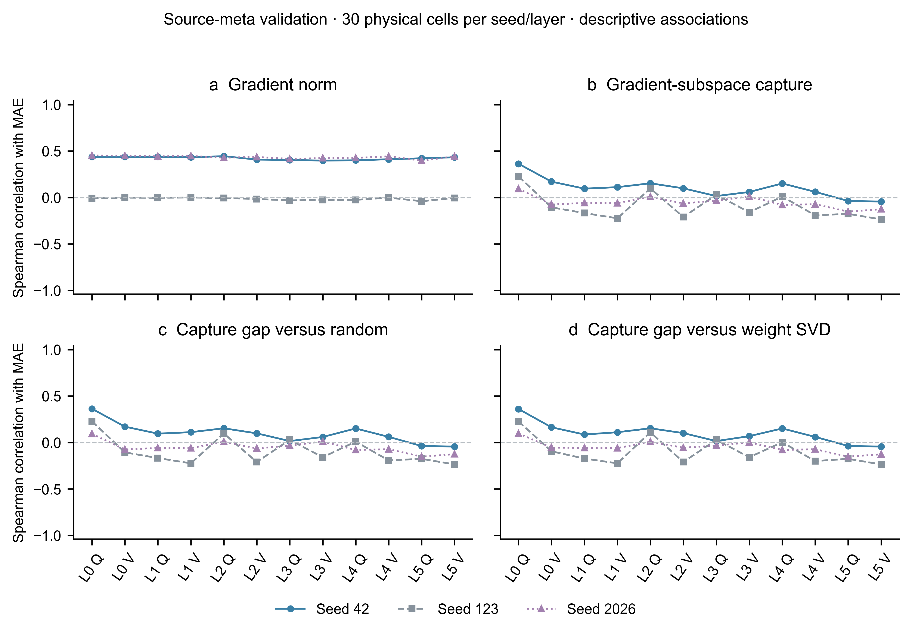

# P1 三种子源梯度子空间与验证误差审计

**P1预注册捕获分支为PASSED，H1状态为`SHARED_SOURCE_LOW_DIMENSIONAL_CAPTURE_SUPPORTED`。**

本阶段使用各seed匹配的P0正式B0预训练冻结模型、已选native_multivariate Bridge和相同cycle-query Head。source85颗/47个exact组估计基方向，meta-validation30颗/15组只用于源开发留出诊断。P1预注册提交为04b6f79dda51e3472a40db33f1fc2fc01fea2b59。

## 实际计算与身份闭环

| seed | source/meta | 主矩阵 | 次矩阵 | 梯度前后向次数 | optimizer updates | 端点重放层梯度 | loss/MAE最大差 |
|---:|---|---:|---:|---:|---:|---:|---:|
| 42 | 85/30 | 12 Q/V | 42 Q/K/V/O/FFN | 345 | 0 | 120 | 6.44e-08 |
| 123 | 85/30 | 12 Q/V | 42 Q/K/V/O/FFN | 345 | 0 | 120 | 1.33e-07 |
| 2026 | 85/30 | 12 Q/V | 42 Q/K/V/O/FFN | 345 | 0 | 120 | 6.25e-08 |

三个seed合计1035次真实梯度前后向、0次optimizer update。每seed315次为source/meta的nominal、绝对单位及source标签置换梯度，10次为独立首末电芯重放，20次为次要候选家族。每次前后向同时提取登记层的梯度。次42个矩阵包含主Q/V矩阵，家族覆盖分别记录。

主集合为六层Q/V共12个384×384矩阵，rank4是预登记主值。r2/4/8/16/40/56/80的谱与投影保留在逐seed文件。次要Q/K/V/O/FFN共42个矩阵只用事先固定source12/meta8，记录mean-SVD谱和individual capture。次家族诊断保持描述性，原Q/V target set继续固定。

source模型before/after指纹逐seed相同，requires_grad和train/eval标志由原审计恢复。公开完成清单全部文件的bytes/SHA重新核验。每seed10个首末端点的120个层梯度独立重放通过。P1 nominal meta loss逐层与同seed正式B0的逐cell验证MAE核对，绝对容差1e-5，观测点数与UID/protocol一致。

P0在服务器完成后出现连接失败，P1切换本机RTX4060 Laptop、Torch2.4.1+cu121执行，结果及缓存保存在本地。源梯度缓存与U/V张量有独立manifest，公共诊断文件保存身份和统计。

## 主rank4留出捕获与稳定性

| 控制 | grad_cov−控制的平均捕获差 | 配对protocol 95%区间 | 有效工况组 | 三seed方向均正 |
|---|---:|---|---:|---|
| random_mean | 0.87151004 | [0.83201826, 0.90801941] | 15 | True |
| weight_svd | 0.87046484 | [0.83235628, 0.90694765] | 15 | True |
| shuffled_cov | -0.00878808 | [-0.03339181, 0.01574839] | 15 | False |

捕获为||UᵀGV||²_F/||G||²_F，U/V来自source梯度双侧二阶能量方向。random_mean平均20个随机正交基控制。先按层汇总同一留出工况的配对差，再配对三个seed中的同一exact protocol，以15个工况为单位重抽2000次。该区间条件于已拟合的三个source seed，seed方向与seed间波动在P1_GATE中单独保留。

基重合bootstrap均值为0.93748262，每seed做30次source工况/电芯重抽基拟合，左右基投影重合均纳入。

| seed | 对random平均捕获差 | 对weight-SVD平均捕获差 | 基重合均值 |
|---:|---:|---:|---:|
| 42 | 0.87754582 | 0.87650402 | 0.95338525 |
| 123 | 0.86537376 | 0.86435169 | 0.93098317 |
| 2026 | 0.87161053 | 0.87053881 | 0.92807944 |

预注册捕获门槛要求相对random和weight-SVD平均差至少0.02、配对protocol区间下界大于0、三个seed方向均正，以及平均基重合至少0.5。实际Gate状态为PASSED，完整数值与输入SHA绑定在P1_GATE.json。

## mean-SVD与组内去均值控制

现有CSV方法名为gradient_mean_svd，对47个源工况的平均梯度等权合并后做SVD。grad_cov对源工况等权、组内电芯等权的梯度二阶能量构造双侧基。demeaned_cov先从每颗源梯度减去其工况平均梯度，再以相同分层权重估计二阶能量。组内去均值有重复电芯支持的源工况为19/47，其余singleton保留零残差贡献。

| seed | 方法 | meta工况均值梯度capture | meta单cell capture均值 | grad_cov−该方法（工况） |
|---:|---|---:|---:|---:|
| 42 | grad_cov | 0.87766406 | 0.85760260 | 0.00000000 |
| 42 | gradient_mean_svd | 0.87309837 | 0.84623838 | 0.00456569 |
| 42 | demeaned_cov | 0.86436663 | 0.85785359 | 0.01329743 |
| 123 | grad_cov | 0.86548548 | 0.87182252 | 0.00000000 |
| 123 | gradient_mean_svd | 0.56629769 | 0.57792068 | 0.29918779 |
| 123 | demeaned_cov | 0.85405263 | 0.87012583 | 0.01143286 |
| 2026 | grad_cov | 0.87172313 | 0.84253472 | 0.00000000 |
| 2026 | gradient_mean_svd | 0.86258479 | 0.82890697 | 0.00913835 |
| 2026 | demeaned_cov | 0.86210664 | 0.84127010 | 0.00961649 |

各seed和逐层值完整保留在P1_MEAN_AND_DEMEANED_CONTROLS.csv与P1_LAYER_CAPTURE_SUMMARY.csv。mean-SVD对照在seed123的捕获差明显大于另两个seed，描述性汇总保留该不均匀性。以上复用既有梯度与控制，原预注册Gate继续保留。

P1_BASIS_STABILITY的30次refit对应grad_cov。全局gradient_mean_svd和demeaned_cov的专属bootstrap稳定性尚有缺口。现有主角度矩阵比较各源工况mean-gradient SVD的左右基，补充概要如下，估计对象为跨源工况一致性。

| seed | 基侧 | 工况对×层记录数 | 投影重合均值 | 平均主角度中位数（度） |
|---:|---|---:|---:|---:|
| 42 | left | 12972 | 0.739648 | 27.1448 |
| 42 | right | 12972 | 0.863993 | 15.5607 |
| 123 | left | 12972 | 0.660638 | 32.5107 |
| 123 | right | 12972 | 0.838001 | 18.1994 |
| 2026 | left | 12972 | 0.687368 | 29.4093 |
| 2026 | right | 12972 | 0.841111 | 17.2547 |

工况对共享源工况，跨层也共享输入，记录数保留组合覆盖含义。LoRA-SB已有mean-gradient导出的冻结基与可训练小核心。P1当前控制提供捕获差，mean-SVD基下的完整下游训练对照仍待补齐。后续相对random或LoRA-XS的P2改善，允许归因于实际被比较的方向与参数预算；相对LoRA-SB的优越性需要对应忠实下游对照。

## 标签置换与容量单位边界

标签置换弱化观测为`False`。真实标签梯度与shuffled_cov的差及区间见上表。当前置换控制缺少退化结局特异性证据。共享梯度捕获可能包含固定Head、Bridge、单cell梯度低秩及共同响应结构的贡献。H1通过范围为固定source checkpoint上的稳定共享梯度方向，退化特异性和电池特异机制继续保持未建立。

source名义容量只有1.1Ah一个取值。absolute_units控制在相同checkpoint上把I/Q/drift恢复A/Ah尺度，再观察梯度；该控制描述输入单位扰动敏感性，跨容量/跨化学体系的不变性仍待独立数据验证。

零更新P1未运行留出模型优化分支，捕获收益表示梯度投影能量差，预测更新收益留待P2实证。

## 梯度、投影与验证误差的描述性关联

每个seed/layer固定30颗独立meta电芯，将gradient_norm、grad_cov/random_mean/weight-SVD捕获及两个捕获差，分别与同seed正式B0的逐cell MAE计算Pearson和Spearman。原始合并表为P1_ERROR_GRADIENT_CAPTURE_CELL.csv，完整系数表为P1_ERROR_ASSOCIATIONS.csv。每层记录N30及15个工况支持，常量或缺少有限支持时保留未定义状态。关联计算属于补充描述分析，无p值、无新增Gate或选层用途。

| seed | 量 | 层数 | Spearman中位数 | 12层范围 |
|---:|---|---:|---:|---|
| 42 | capture_gap_vs_random | 12 | 0.09700 | [-0.04383, 0.36329] |
| 42 | capture_gap_vs_weight_svd | 12 | 0.09366 | [-0.04383, 0.36107] |
| 42 | capture_grad_cov | 12 | 0.09700 | [-0.04383, 0.36329] |
| 42 | capture_random_mean | 12 | 0.06630 | [-0.35573, 0.33081] |
| 42 | capture_weight_svd | 12 | 0.03648 | [-0.17820, 0.45984] |
| 42 | gradient_norm | 12 | 0.42736 | [0.39666, 0.44472] |
| 123 | capture_gap_vs_random | 12 | -0.16307 | [-0.23560, 0.22759] |
| 123 | capture_gap_vs_weight_svd | 12 | -0.16574 | [-0.23560, 0.22759] |
| 123 | capture_grad_cov | 12 | -0.16307 | [-0.23560, 0.22759] |
| 123 | capture_random_mean | 12 | -0.04828 | [-0.33704, 0.43048] |
| 123 | capture_weight_svd | 12 | -0.02825 | [-0.25295, 0.18176] |
| 123 | gradient_norm | 12 | -0.00623 | [-0.04027, -0.00022] |
| 2026 | capture_gap_vs_random | 12 | -0.06185 | [-0.15239, 0.09321] |
| 2026 | capture_gap_vs_weight_svd | 12 | -0.05762 | [-0.15239, 0.09677] |
| 2026 | capture_grad_cov | 12 | -0.06185 | [-0.15239, 0.09321] |
| 2026 | capture_random_mean | 12 | 0.01646 | [-0.33437, 0.27208] |
| 2026 | capture_weight_svd | 12 | 0.00467 | [-0.25117, 0.41090] |
| 2026 | gradient_norm | 12 | 0.43915 | [0.39666, 0.45228] |



图展示全部12个主QV矩阵和三个source seed的Spearman系数。每点使用相同30颗物理电芯；跨seed共享电芯、同cell跨层及工况相关性保留在解释中。Spearman衡量秩关联，Pearson原值线性关联同时完整输出。这些关系用于描述当前checkpoint的误差结构，因果性、误差可预测性及真实PEFT更新改善仍需对应实验。

## 优势与劣势（风险）

- 优势为source/meta工况和物理UID互斥、三seed配对、梯度端点重放、source状态指纹及明确的random/W-SVD/label-shuffle控制。
- 劣势（风险）为label-shuffle控制缺少弱化、source容量恒定、有限47源工况/15元验证工况，以及固定Head/Bridge可能产生共同梯度方向。source-meta已用于P0选择，队列也有历史探索暴露，当前证据属于retrospective源开发。

## 目标隔离、后续阶段与复现

全部最终target Query未来标签均未用于本阶段梯度、基拟合、关联或Gate计算。cohort缓存可整体载入内存，监督用途由注册UID角色限制。现有历史探索暴露已记录，评估解释保留该前史。

P2按原登记矩阵比较标准LoRA、忠实LoRA-XS、weight-SVD core、gradient-core、random-core和LoRA-GA，执行同rank与近参数匹配对照。P1共享捕获通过仍需P2预测误差证明方向来源价值，H2/H3等待P3/P4。

```powershell
& D:\Anaconda\envs\tslib\python.exe -m scripts.drs_peft.summarize_p1
```

锁定gradient_audit、run_p1、train、peft和全部配置保持原字节，本CLI仅审读既有产物并生成补充统计与报告。Gate由原aggregate入口生成，本CLI保留其原始决定。

## 置信度与拓展思考

文件身份、分母、零更新、loss/MAE闭合及预注册捕获判定的置信度为高，均有实际记录与重放。退化特异性、跨容量不变性和下游少样本收益的证据仍不足。下一步由P2真实预测比较区分稳定共享方向与可利用适配方向。
