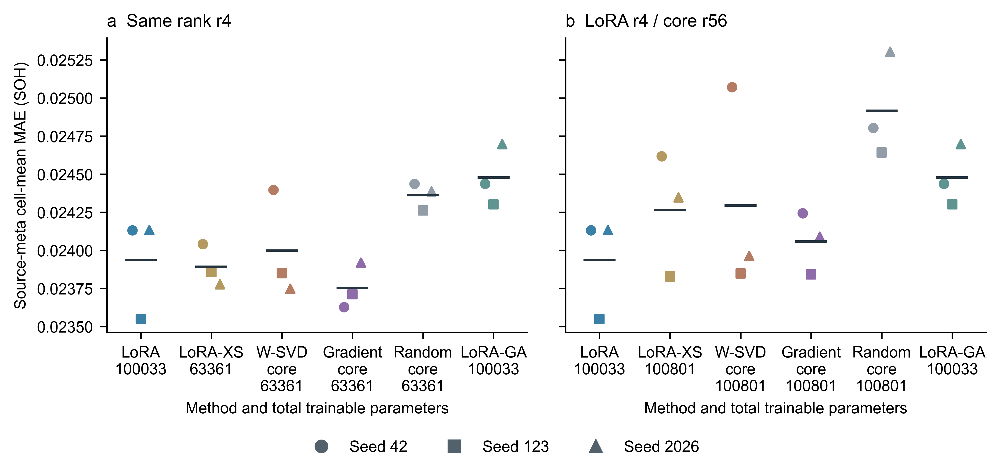
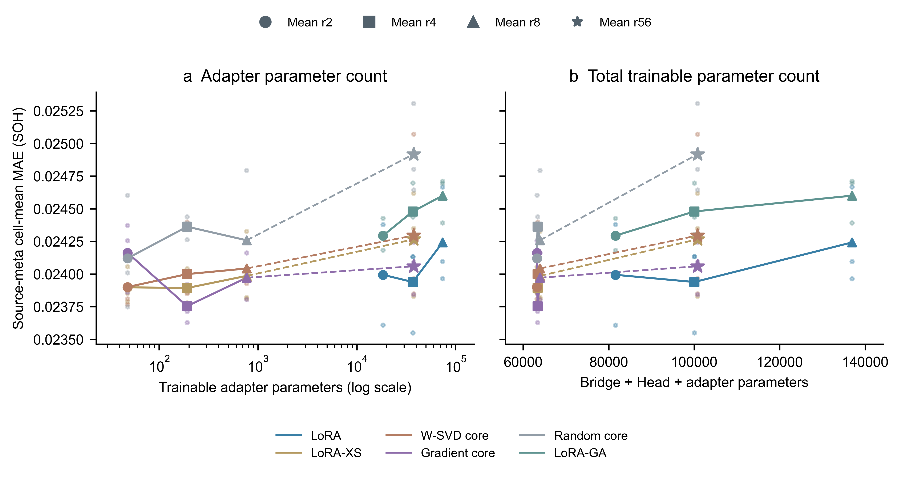
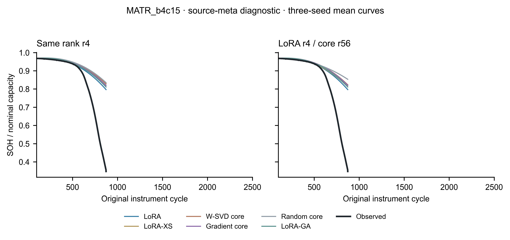
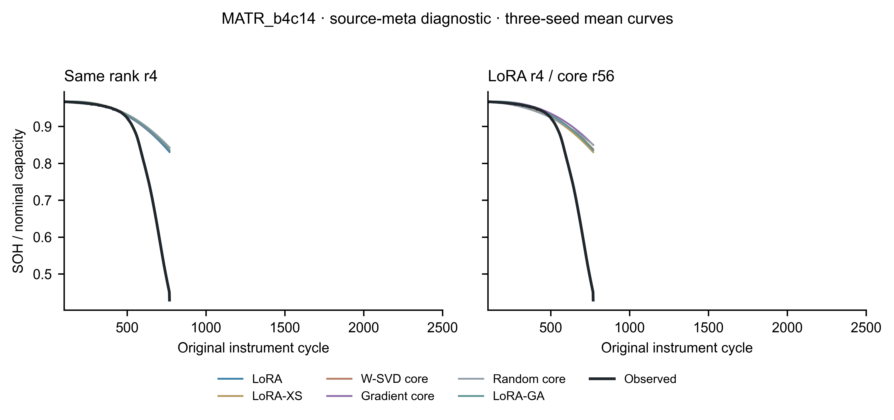
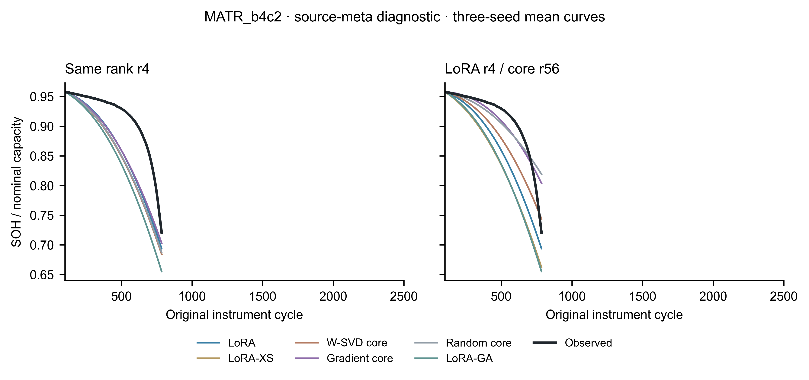

# P2 源域低维PEFT受控比较

**当前交付状态为NEGATIVE。**

已核验LR搜索18/18、正式单元66/66。已闭环单元的source optimizer updates为搜索11880、正式87120，合计99000。

全部登记搜索与正式单元已闭环，当前累计覆盖本轮完整P2预算。

本formatter只读运行凭据、私有完整预测和原run_p2生成的Gate。阶段判断由原Gate决定。每个完成单元重新检查公开/私有SHA、共同P0 B0起点、source scaler、source85/meta30角色、Head、loss、查询网格、选权及真实参数。未来标签来自30颗已允许source-meta电芯的预测包，最终target Query保持sealed。

## 预算与真实搜索成本

| 方法 | 选定adapter LR | 搜索试验数 | 每次epoch/update |
|---|---:|---:|---|
| lora | 0.001 | 3 | 60/660 |
| lora_xs | 0.0001 | 3 | 60/660 |
| weight_svd_core | 0.001 | 3 | 60/660 |
| grad_core | 0.001 | 3 | 60/660 |
| random_core | 0.1 | 3 | 60/660 |
| lora_ga | 0.0001 | 3 | 60/660 |

跨阶段已闭环真实源训练共102个单元、118800次optimizer update，其中P0为18个单元/19800次，P2为84个单元/99000次。P1另有1035次真实梯度前后向、0次optimizer update。工程smoke、合成恢复和测试单独记账。

LR搜索固定seed42、rank4，每方法三个登记候选。选定值固定用于全部正式seed与rank2/4/8/56，共享Bridge/Head LR为0.0003。完整试验及选权见P2_SEARCH_TRIALS.csv与P2_LR_SELECTION.json。

搜索作业墙钟秒合计为1511.514，当前正式作业墙钟秒合计为12399.674。每单元记录训练与逐epoch验证墙钟时间，多个worker并行时分别记账。峰值allocated/reserved显存在P2_METRICS.csv逐单元保存。核函数活跃时长尚无独立计时。

所有方法共享56832个Bridge和6337个Head可训练参数。LoRA r4 adapter为36864，core r4为192。core r56为37632，相对LoRA r4 adapter多768，差2.0833%。含共同Bridge/Head后的总量为100801与100033。P2_PARAM_BUDGET.csv逐单元列出全部参数、U/V、补偿、XS奇异值及source inactive flag buffer元素。U/V和补偿采用真实参数报告，XS/flag额外元素按已锁实现及该单元真实rank列示。

## 正式逐seed结果

| 设置 | 方法 | rank | seed | MAE | RMSE | protocol宏MAE | epoch/update |
|---|---|---:|---:|---:|---:|---:|---|
| primary | lora | 4 | 42 | 0.02413245 | 0.04224274 | 0.01945082 | 120/1320 |
| primary | lora | 4 | 123 | 0.02354955 | 0.04094150 | 0.01932004 | 120/1320 |
| primary | lora | 4 | 2026 | 0.02413331 | 0.04189280 | 0.01992926 | 120/1320 |
| primary | lora_xs | 4 | 42 | 0.02404149 | 0.04203902 | 0.01906038 | 120/1320 |
| primary | lora_xs | 4 | 123 | 0.02385793 | 0.04261578 | 0.01937760 | 120/1320 |
| primary | lora_xs | 4 | 2026 | 0.02377852 | 0.04226507 | 0.01911159 | 120/1320 |
| primary | weight_svd_core | 4 | 42 | 0.02439840 | 0.04228002 | 0.01936210 | 120/1320 |
| primary | weight_svd_core | 4 | 123 | 0.02385041 | 0.04262367 | 0.01938635 | 120/1320 |
| primary | weight_svd_core | 4 | 2026 | 0.02374857 | 0.04208041 | 0.01905319 | 120/1320 |
| primary | grad_core | 4 | 42 | 0.02362805 | 0.04113144 | 0.01907310 | 120/1320 |
| primary | grad_core | 4 | 123 | 0.02371275 | 0.04239198 | 0.01948315 | 120/1320 |
| primary | grad_core | 4 | 2026 | 0.02392054 | 0.04282469 | 0.01927352 | 120/1320 |
| primary | random_core | 4 | 42 | 0.02443757 | 0.04311676 | 0.01937639 | 120/1320 |
| primary | random_core | 4 | 123 | 0.02426244 | 0.04367918 | 0.01969260 | 120/1320 |
| primary | random_core | 4 | 2026 | 0.02438781 | 0.04358434 | 0.01975140 | 120/1320 |
| primary | lora_ga | 4 | 42 | 0.02443694 | 0.04352602 | 0.01964847 | 120/1320 |
| primary | lora_ga | 4 | 123 | 0.02430220 | 0.04213054 | 0.01938779 | 120/1320 |
| primary | lora_ga | 4 | 2026 | 0.02469779 | 0.04256912 | 0.01948790 | 120/1320 |
| parameter_matched | lora_xs | 56 | 42 | 0.02461836 | 0.04208020 | 0.01984905 | 120/1320 |
| parameter_matched | lora_xs | 56 | 123 | 0.02382956 | 0.04167686 | 0.01913932 | 120/1320 |
| parameter_matched | lora_xs | 56 | 2026 | 0.02434911 | 0.04303146 | 0.01943169 | 120/1320 |
| parameter_matched | weight_svd_core | 56 | 42 | 0.02507219 | 0.04301208 | 0.02022302 | 120/1320 |
| parameter_matched | weight_svd_core | 56 | 123 | 0.02384881 | 0.04293270 | 0.01962803 | 120/1320 |
| parameter_matched | weight_svd_core | 56 | 2026 | 0.02396355 | 0.04269499 | 0.01928337 | 120/1320 |
| parameter_matched | grad_core | 56 | 42 | 0.02424379 | 0.04231226 | 0.02024062 | 120/1320 |
| parameter_matched | grad_core | 56 | 123 | 0.02384200 | 0.04285997 | 0.01991741 | 120/1320 |
| parameter_matched | grad_core | 56 | 2026 | 0.02409170 | 0.04239568 | 0.01995658 | 120/1320 |
| parameter_matched | random_core | 56 | 42 | 0.02480388 | 0.04602368 | 0.02093822 | 120/1320 |
| parameter_matched | random_core | 56 | 123 | 0.02464370 | 0.04596324 | 0.02104863 | 120/1320 |
| parameter_matched | random_core | 56 | 2026 | 0.02530627 | 0.04819276 | 0.02140220 | 120/1320 |
| rank_curve | lora | 2 | 42 | 0.02399392 | 0.04124815 | 0.01955933 | 120/1320 |
| rank_curve | lora | 2 | 123 | 0.02360857 | 0.04063010 | 0.01922491 | 120/1320 |
| rank_curve | lora | 2 | 2026 | 0.02437859 | 0.04428519 | 0.01987635 | 120/1320 |
| rank_curve | lora_xs | 2 | 42 | 0.02405598 | 0.04233552 | 0.01914182 | 120/1320 |
| rank_curve | lora_xs | 2 | 123 | 0.02385087 | 0.04147274 | 0.01912535 | 120/1320 |
| rank_curve | lora_xs | 2 | 2026 | 0.02378728 | 0.04223667 | 0.01911629 | 120/1320 |
| rank_curve | weight_svd_core | 2 | 42 | 0.02412555 | 0.04266632 | 0.01926147 | 120/1320 |
| rank_curve | weight_svd_core | 2 | 123 | 0.02376586 | 0.04196690 | 0.01921875 | 120/1320 |
| rank_curve | weight_svd_core | 2 | 2026 | 0.02380929 | 0.04231797 | 0.01914637 | 120/1320 |
| rank_curve | grad_core | 2 | 42 | 0.02437184 | 0.04436415 | 0.02014180 | 120/1320 |
| rank_curve | grad_core | 2 | 123 | 0.02386003 | 0.04243703 | 0.01935027 | 120/1320 |
| rank_curve | grad_core | 2 | 2026 | 0.02425432 | 0.04286183 | 0.01954419 | 120/1320 |
| rank_curve | random_core | 2 | 42 | 0.02460324 | 0.04458190 | 0.02019944 | 120/1320 |
| rank_curve | random_core | 2 | 123 | 0.02400901 | 0.04221345 | 0.01924794 | 120/1320 |
| rank_curve | random_core | 2 | 2026 | 0.02374892 | 0.04268658 | 0.01920256 | 120/1320 |
| rank_curve | lora_ga | 2 | 42 | 0.02442694 | 0.04213530 | 0.01944889 | 120/1320 |
| rank_curve | lora_ga | 2 | 123 | 0.02427146 | 0.04218738 | 0.01968668 | 120/1320 |
| rank_curve | lora_ga | 2 | 2026 | 0.02418346 | 0.04137353 | 0.01943037 | 120/1320 |
| rank_curve | lora | 8 | 42 | 0.02409529 | 0.04235261 | 0.01960605 | 120/1320 |
| rank_curve | lora | 8 | 123 | 0.02396363 | 0.04166384 | 0.01952960 | 120/1320 |
| rank_curve | lora | 8 | 2026 | 0.02466597 | 0.04381443 | 0.01982266 | 120/1320 |
| rank_curve | lora_xs | 8 | 42 | 0.02432665 | 0.04286966 | 0.01933975 | 120/1320 |
| rank_curve | lora_xs | 8 | 123 | 0.02380983 | 0.04180041 | 0.01917946 | 120/1320 |
| rank_curve | lora_xs | 8 | 2026 | 0.02382026 | 0.04232971 | 0.01913317 | 120/1320 |
| rank_curve | weight_svd_core | 8 | 42 | 0.02424744 | 0.04468379 | 0.01991778 | 120/1320 |
| rank_curve | weight_svd_core | 8 | 123 | 0.02392752 | 0.04318410 | 0.01941026 | 120/1320 |
| rank_curve | weight_svd_core | 8 | 2026 | 0.02395180 | 0.04197002 | 0.01908345 | 120/1320 |
| rank_curve | grad_core | 8 | 42 | 0.02416101 | 0.04206447 | 0.01949458 | 120/1320 |
| rank_curve | grad_core | 8 | 123 | 0.02380274 | 0.04231919 | 0.01918518 | 120/1320 |
| rank_curve | grad_core | 8 | 2026 | 0.02395092 | 0.04254274 | 0.01900029 | 120/1320 |
| rank_curve | random_core | 8 | 42 | 0.02395463 | 0.04282971 | 0.01906742 | 120/1320 |
| rank_curve | random_core | 8 | 123 | 0.02479316 | 0.04428943 | 0.02022013 | 120/1320 |
| rank_curve | random_core | 8 | 2026 | 0.02402693 | 0.04379816 | 0.01971049 | 120/1320 |
| rank_curve | lora_ga | 8 | 42 | 0.02471214 | 0.04241454 | 0.01927415 | 120/1320 |
| rank_curve | lora_ga | 8 | 123 | 0.02439170 | 0.04280594 | 0.01955940 | 120/1320 |
| rank_curve | lora_ga | 8 | 2026 | 0.02469615 | 0.04330860 | 0.01955292 | 120/1320 |

## 固定source-meta监督支持

| 时距 | 独立物理电芯 | 真实观测点 |
|---|---:|---:|
| all | 30 | 21827 |
| 101_200 | 30 | 2999 |
| 201_500 | 30 | 8777 |
| 501_1000 | 28 | 8602 |
| 1001_plus | 5 | 1449 |

## 两预算三seed均值

| 预算 | 方法 | rank | MAE均值 | RMSE均值 | MAE seed范围 | 总可训练参数 |
|---|---|---:|---:|---:|---|---:|
| rank_matched | lora | 4 | 0.02393844 | 0.04169235 | [0.02354955, 0.02413331] | 100033 |
| rank_matched | lora_xs | 4 | 0.02389265 | 0.04230662 | [0.02377852, 0.02404149] | 63361 |
| rank_matched | weight_svd_core | 4 | 0.02399913 | 0.04232803 | [0.02374857, 0.02439840] | 63361 |
| rank_matched | grad_core | 4 | 0.02375378 | 0.04211604 | [0.02362805, 0.02392054] | 63361 |
| rank_matched | random_core | 4 | 0.02436261 | 0.04346010 | [0.02426244, 0.02443757] | 63361 |
| rank_matched | lora_ga | 4 | 0.02447898 | 0.04274189 | [0.02430220, 0.02469779] | 100033 |
| parameter_matched | lora | 4 | 0.02393844 | 0.04169235 | [0.02354955, 0.02413331] | 100033 |
| parameter_matched | lora_xs | 56 | 0.02426568 | 0.04226284 | [0.02382956, 0.02461836] | 100801 |
| parameter_matched | weight_svd_core | 56 | 0.02429485 | 0.04287992 | [0.02384881, 0.02507219] | 100801 |
| parameter_matched | grad_core | 56 | 0.02405916 | 0.04252264 | [0.02384200, 0.02424379] | 100801 |
| parameter_matched | random_core | 56 | 0.02491795 | 0.04672656 | [0.02464370, 0.02530627] | 100801 |
| parameter_matched | lora_ga | 4 | 0.02447898 | 0.04274189 | [0.02430220, 0.02469779] | 100033 |

主指标先对各物理电芯的全部真实未来点平均，再跨电芯等权。四时距MAE/RMSE、支持电芯数与观测点数保存在P2_METRICS.csv。P2_CELL_METRICS.csv保留每cell的full及四时距误差和支持数。正式完成后各单元均为120epochs/1320updates，所选epoch为本单元source-meta MAE的首次严格最小值。

## 原Gate与配对区间

原Gate状态为NEGATIVE，P3/P4大矩阵放行为False。

| 预算 | 参照 | candidate/reference rank | 相对MAE改善 | 绝对MAE改善cell 95%区间 | protocol 95%区间 | 三seed均正 |
|---|---|---|---:|---|---|---|
| rank_matched_primary | lora_xs | 4/4 | 0.005812 | [-0.00098226, 0.00120227] | [-0.00057465, 0.00042271] | False |
| actual_parameter_matched_primary | lora_xs | 56/56 | 0.008510 | [-0.00290378, 0.00488088] | [-0.00211311, 0.00120783] | False |
| rank_matched_primary | random_core | 4/4 | 0.024990 | [-0.00019913, 0.00143395] | [-0.00001829, 0.00073021] | True |
| actual_parameter_matched_primary | random_core | 56/56 | 0.034464 | [-0.00159685, 0.00243181] | [0.00004371, 0.00200836] | True |
| rank_matched_primary | weight_svd_core | 4/4 | 0.010223 | [-0.00094887, 0.00128912] | [-0.00048441, 0.00048724] | False |
| actual_parameter_matched_primary | weight_svd_core | 56/56 | 0.009701 | [-0.00096509, 0.00187731] | [-0.00159151, 0.00080672] | False |
| rank_matched_primary | lora | 4/4 | 0.007714 | [-0.00088523, 0.00129435] | [-0.00071598, 0.00171283] | False |
| actual_parameter_matched_primary | lora | 56/4 | -0.005043 | [-0.00251039, 0.00306527] | [-0.00189039, 0.00119430] | False |
| rank_matched_primary | lora_ga | 4/4 | 0.029625 | [-0.00036161, 0.00233112] | [-0.00023569, 0.00083717] | True |
| actual_parameter_matched_primary | lora_ga | 56/4 | 0.017150 | [-0.00242902, 0.00467285] | [-0.00203823, 0.00107175] | True |

candidate固定为grad_core，区间取参照MAE减candidate MAE的绝对改善。相对改善为独立列。原统计先将三个seed同cell的配对改善平均，再按30个物理cell或15个exact protocol重抽2000次。cell区间对应电芯等权平均改善，protocol区间对应工况等权宏平均改善。source seed原值与方向单独保留，区间条件于已拟合seed、已选LR及复用的source-meta集合。

## 阴性门槛与混合结果

预注册P2门槛要求gradient-core在两预算下相对LoRA-XS与random-core均达到至少1%平均相对改善，cell与protocol区间下界均大于0，且三个seed改善方向均正。以下保留原Gate四项主控制。

| 预算 | 参照 | 平均相对MAE改善 | cell区间下界>0 | protocol区间下界>0 | 三seed均正 |
|---|---|---:|---|---|---|
| rank_matched_primary | lora_xs | 0.5812% | False | False | False |
| actual_parameter_matched_primary | lora_xs | 0.8510% | False | False | False |
| rank_matched_primary | random_core | 2.4990% | False | False | True |
| actual_parameter_matched_primary | random_core | 3.4464% | False | True | True |

gradient-core相对LoRA-XS的两个预算平均改善均低于1%，两类区间均跨0，seed方向混合。相对random-core存在平均改善，两个预算cell区间均跨0。参数匹配预算的protocol区间为正。这些混合证据保留原值，P2判定为NEGATIVE。P1通过的窄共享梯度捕获尚未转化为预注册的下游优势。

P3/P4/P5记录NOT_RUN_NEGATIVE_P2_GATE，H2/H3本轮未评估。全部最终target Query保持未评分，当前研究结束于已完成的source阶段阴性门槛。



每种方法显示三个seed原始MAE，短横线为seed均值，横轴标签给出包含Bridge/Head的总可训练参数。



完整参数曲线覆盖六方法的r2/r4/r8及四个core方法的r56。淡色点为三个source seed原始值，实线依次连接r2/r4/r8的三seed均值。r56用星形和从r8延伸的虚线单独标记。左轴采用adapter参数量的log坐标，右轴给出包含共同Bridge/Head的实际可训练量。seed点的离散表示训练重复，配对CI继续以表中物理电芯与工况重抽样定义解释。

## 源验证轨迹反例

反例按primary grad_core r4的三seed逐cell MAE均值，在固定30颗source-meta电芯中降序选择前三，UID打破同分。相同三颗在两预算下叠加六方法。曲线为三seed预测均值，评分仍分别计算各seed误差后平均。预测已在101–5000公共网格生成，绘图仅显示真实评分位置，固定展示窗101–2500覆盖本域全部已资格观测。P2_ERROR_COUNTEREXAMPLES.csv同时保留candidate相对各参照变差的全部source-meta电芯。








## 优势与劣势（风险）

- 优势为共同B0初态、相同Head/Bridge、等搜索次数、相同更新预算、三seed原值及近实际参数匹配。
- 劣势（风险）为source-meta同时用于epoch/LR选择和报告，P1标签置换控制未弱化，以及外域子空间失配。mean-SVD基完整下游训练仍有缺口，相对LoRA-SB的优越性需要忠实对应对照。

FULL_FINETUNE属于合同可选资源参照，本轮没有登记及运行。当前矩阵的计算选择和硬件可行性分别记录。这些源开发结果维持retrospective解释，H2/H3按当前阶段门槛记录评估状态。

## 缺失或未闭环单元

全部登记单元已通过本formatter的凭据与指标核验。

## 复现与证据范围

```powershell
& D:\Anaconda\envs\tslib\python.exe -m scripts.drs_peft.summarize_p2
```

运行产生P2_METRICS、P2_PARAM_BUDGET、P2_CELL_METRICS、P2_ERROR_COUNTEREXAMPLES及P2_FORMATTER_AUDIT。完整NPZ预测保存在runtime/drs_peft/P2各run目录，图文由其实际值重建。原run_p2、train、peft、配置及Gate继续保持锁定字节。

算子与首个真实单元的独立CPU审计见research/drs_peft/P2_IMPLEMENTATION_AUDIT_ZH.md。文件身份、分母与误差重算的置信度依据已通过的记录。方法效应以完整原Gate和对应比较范围解释。

本轮最终工程套件实测61项通过，运行耗时59.94秒。工程验证与正式模型性能分别记账。

## 关键源码与状态指纹

| 文件 | SHA256 |
|---|---|
| scripts/drs_peft/run_p2.py | 59536a2b752105c1c5858ac8c9939309e39ffe64b8bb1058a626ff6067a9351c |
| scripts/drs_peft/train.py | ebe562930e80697e01ffd103246a6a5263f6b1123c191e9e8efca8b9474aba70 |
| models/drs_peft/peft.py | 49272bc035b6fd0984eae08f1f4b5bb402b6b46c958fd9e8a0505c0c44ccdfa9 |
| configs/drs_peft/execution_v1.json | 868b55908c3bedefd53400f7e9ebb4491dcd8c405719cc84f27528fb2623e8df |
| configs/drs_peft/episodes_v1.json | b9e6b41522055c1ba6b0b995f8bc23821e7878c89ff0de8950a6724eaa34942c |
| results/drs_peft/P1/P1_GATE.json | d715180b8868010210ae32952710422eff6d267d7d7cf6e7c4e45e7cccfe601b |
| results/drs_peft/P2/P2_LR_SELECTION.json | c79b71d562a19b9f0c43c0e818bda2c191aa3c42c2e548aad22057545e2684c9 |
| results/drs_peft/P2/P2_GATE.json | 7768f007087e71988022b41998f0c53905db072ea513cd1dd5fc9491ef6d6233 |

拓展思考与后续关注保留P2阴性、分工况误差及高误差个体，后续研究版本以这些证据和原Gate边界为起点。
